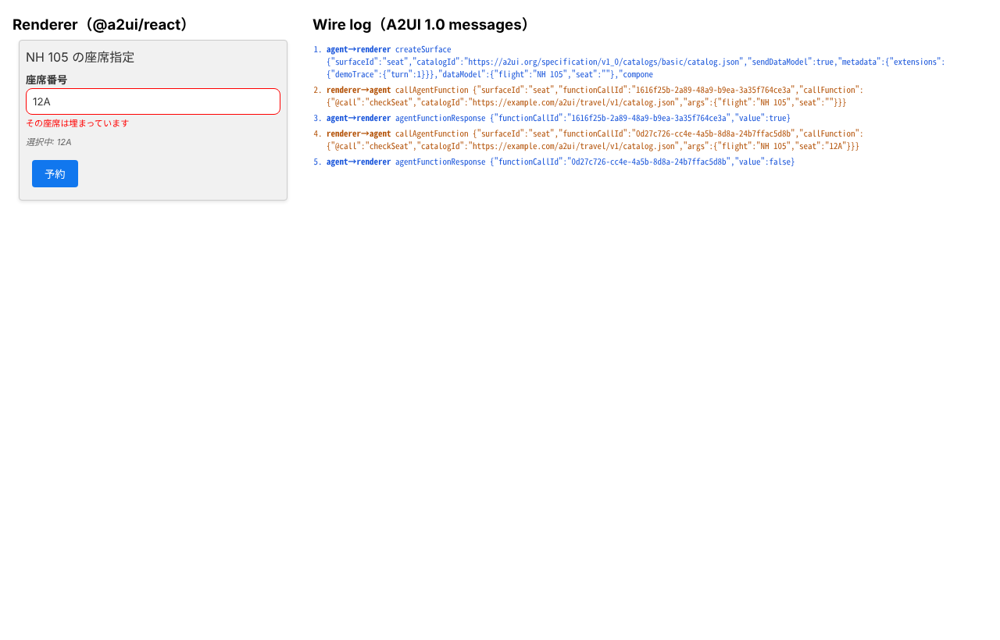
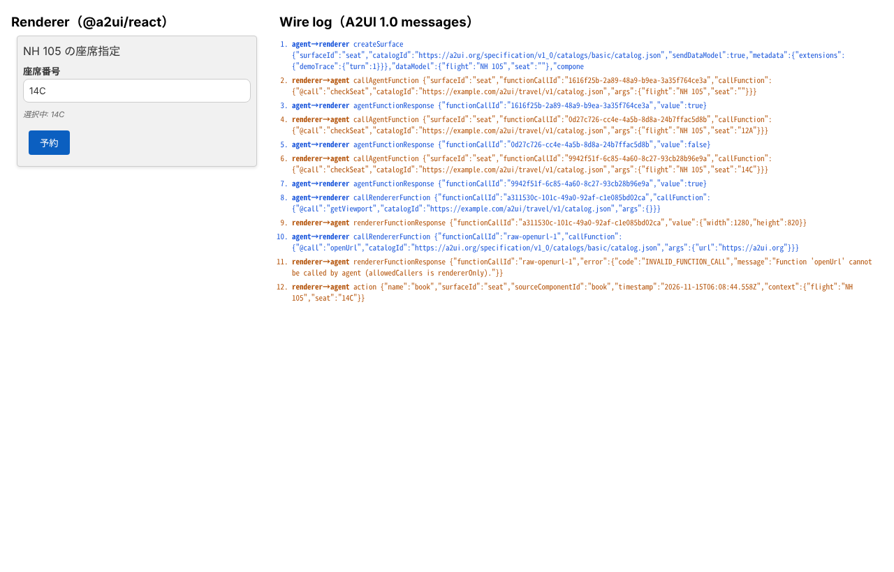

エージェントに「この便の座席を指定したい」と伝えたとき、その場で操作できるフォームが返ってくると便利だ。ただし、座席番号を入力するたびにLLMへ問い合わせると、小さな入力確認にも応答を待つことになる。

2026年11月11日、[A2UI 1.0](https://developers.googleblog.com/a2ui-10-build-delightful-fast-reliable-agentic-experiences/)が初の安定版として公開された。A2UIは、エージェントが操作可能な画面を返すための仕組みだ。1.0では、画面を表示する側とエージェント側の間で、互いの関数を呼び出せるようになった。この機能を使うと、画面の構成と、空席確認のような細かな照会を分けて実装できる。

この記事では、座席指定フォームの検証をもとに、1.0の使いどころを見ていく。あわせて、画面を短く記述するExpress、コンポーネントをまとめて扱うPython Macros、旧版からの移行時の注意点を整理する。

## A2UIは、画面の構成をデータで伝える仕組み

A2UI（Agent-to-User Interface）は、エージェントが画面の構成をJSONで伝えるためのプロトコルだ。

たとえば「入力欄と予約ボタンを表示する」とエージェントが伝えると、受け取ったアプリは登録済みのコンポーネントを使ってフォームを表示する。この描画を担当するのがレンダラーだ。エージェントは、画面を実行するためのHTMLやJavaScriptを送る必要がない。

使えるコンポーネントや関数は、カタログに定義する。カタログには、コンポーネントの名前、設定できる項目、関数の引数などを記載する。アプリ側が対応するコンポーネントの範囲で、エージェントが画面を組み立てる仕組みである。

## 画面を作る処理と、入力を確かめる処理を分ける

座席指定を例に、処理の流れを見てみよう。

1. ユーザーが「座席を指定したい」と伝える。
2. エージェントがLLMを使ってフォームの構成を作る。
3. SDKが出力を検証・変換し、レンダラーへ送る。
4. レンダラーがフォームを表示する。
5. ユーザーが座席番号を入力すると、エージェント側の関数に空席を問い合わせる。

ここでは、LLMをユーザーの要望に合う画面構成の生成に使い、SDKは出力の検証・変換やメッセージ処理を担う。

手順5の空席確認では、LLMを呼ばずに通常のコードで結果を返せる。このように、通信の相手側にある関数を呼び出す仕組みをRPC（Remote Procedure Call）と呼ぶ。A2UI 1.0では、レンダラーからエージェントへも、逆方向へも関数を呼び出せる。

```text
画面を作る: エージェント → LLM → SDK → レンダラー
空席を調べる: レンダラー ⇄ エージェント側の関数
予約ボタンを押す: レンダラー → action → エージェント側の処理
```

`action` は、ボタン操作などをエージェントへ知らせるメッセージだ。受信後にLLMへ次の応答を求めるか、業務処理を実行するかは、アプリ側で決める。

処理ごとの役割を整理すると、次のようになる。

| 役割 | 担当する処理 |
| --- | --- |
| LLM | ユーザーの要望に応じて、画面に置くコンポーネントやデータを選ぶ |
| エージェント | 会話の進行、LLMの呼び出し、業務APIとの連携を行う |
| A2UI Agent SDK | LLMへ渡す説明の作成、出力の検証・変換、関数呼び出しの処理を助ける |
| レンダラー | メッセージを画面へ反映し、入力や操作をエージェントへ伝える |
| ホストアプリ | 使用できるコンポーネントや関数を登録し、画面の見た目を決める |

## 検証した範囲と実行環境

この記事の動作結果は、2026年11月15日に実施した検証の記録（コード、通信ログ、スクリーンショット）に基づいている。執筆時点での再ビルドやブラウザの再操作は行っていない。

検証では、LLMの出力を手書きのExpressテキストで代用した。Expressは画面構成を短く記述するための形式で、詳しくは後の節で説明する。エージェントもブラウザ内で動く簡易的な実装を使っており、実際のLLMによる画面生成や、本番の予約APIとの接続は検証していない。

| 対象 | 検証で使用したもの |
| --- | --- |
| TypeScript版のSDKとReactレンダラー | GitHubの `main` ブランチにあるコミット `3ed9601` のビルド |
| 比較用のnpmパッケージ | `@a2ui/web_core` 0.15.0、`@a2ui/react` 0.15.0、`@a2ui/agent` 0.1.0 |
| Python版のSDK | `a2ui-agent-sdk` 0.11.0 |
| ブラウザ | Playwrightで操作したHeadless Chrome |
| 空席情報 | 「12Aと12Bは使用中」とする固定データ |

### npm版と検証用ビルドの違い

11月15日時点で比較したnpm版には、次の違いがあった。

- `@a2ui/web_core` 0.15.0は、`@accessibility` や `@checks` を検証エラーにした。
- `@a2ui/agent` 0.1.0は、`RendererToAgentMessageProcessor` と `AgentFunction` を公開APIに含んでいなかった。

一方、レンダラー側の関数を呼び出す処理や、呼び出し元を制限する仕組み（後述の `allowedCallers`）が機能する場面もあった。すべての1.0機能が未対応だったわけではない。なお、レンダラー側に実装のない関数をエージェントへ転送する動作については、npm版では未確認である。

この比較の対象は、表に挙げたバージョンに限られる。利用時には、使うバージョンの更新履歴と公開APIを確認しておく必要がある。11月17日時点のnpm最新版では再検証していない。

同梱の[検証コード](/article-assets/a2ui-1-0/code/README.md)に、構築手順と実行の前提をまとめた。検証時の状態を再現する場合は、依存関係を入れる前にコミットを固定し、コード内の絶対パスも手元の配置に合わせて変更する必要がある。検証コード一式は[ZIPファイル](/article-assets/a2ui-1-0/a2ui-1-0-samples.zip)でダウンロードできる。

## 座席指定フォームで関数を呼び合う

フォームには、座席番号の入力欄と予約ボタンを置く。座席番号を入力すると、エージェント側の `checkSeat` 関数で空席を確認する。検証用の関数は、`12A` と `12B` なら `false`、それ以外なら `true` を返す。便を表す `flight` 引数も渡すが、この簡易実装では判定に使っていない。

### カタログで関数を宣言する

まず、使う関数と引数をカタログに定義する。以下は[カタログ定義](/article-assets/a2ui-1-0/code/web/travel_catalog.json)の抜粋で、必須項目の指定などは一部省略した。

```json
{
  "catalogId": "https://example.com/a2ui/travel/v1/catalog.json",
  "protocolVersion": "1.0",
  "functions": {
    "checkSeat": {
      "description": "座席が空いているかをエージェント側の予約システムで確認する。",
      "returnType": "boolean",
      "properties": {
        "@call": { "const": "checkSeat" },
        "args": { "type": "object",
          "properties": { "flight": {"$ref": "common_types.json#/$defs/DynamicString"},
                          "seat":   {"$ref": "common_types.json#/$defs/DynamicString"} },
          "required": ["flight", "seat"] }
      }
    },
    "getViewport": {
      "description": "レンダラーの表示領域サイズを返す（エージェントから呼び出し可）。",
      "returnType": "object",
      "allowedCallers": "rendererOrAgent",
      "properties": { "@call": { "const": "getViewport" }, "args": { "type": "object" } }
    }
  }
}
```

`checkSeat` は、レンダラー側には実装を置かず、関数の定義だけを登録する。レンダラーがこの関数を評価すると、`callAgentFunction` でエージェントへ処理を依頼する。仕様では、この転送をfallback routingと呼んでいる。

`allowedCallers` は、関数を呼び出せる側を指定する項目だ。`checkSeat` は省略しているので、既定値の `rendererOnly` になる。これは「レンダラーから呼び出せる」という意味で、実行場所を制限する値ではない。そのため、レンダラーから呼び出してエージェントへ転送する今回の構成でも問題なく動作する。

一方、`getViewport` はレンダラー側に実装する。`rendererOrAgent` を指定し、エージェントからも表示領域のサイズを取得できるようにする。

### 入力欄のチェックに関数を指定する

入力欄の値は、データバインディングでデータモデルの `/seat` と結び付ける。チェック条件には、必須入力の確認と `checkSeat` を指定する。

```json
{ "id": "seatField", "component": "TextField", "label": "座席番号", "value": {"@path": "/seat"},
  "@checks": [
    { "condition": {"@call": "required", "args": {"value": {"@path": "/seat"}}}, "message": "座席番号を入力してください" },
    { "condition": {"@call": "checkSeat", "catalogId": "https://example.com/a2ui/travel/v1/catalog.json",
                    "args": {"flight": {"@path": "/flight"}, "seat": {"@path": "/seat"}}},
      "message": "その座席は埋まっています" }
  ] }
```

### エージェント側（`@a2ui/agent`）

エージェント側では、`checkSeat` の実装とメッセージの処理を登録する。以下は接続部分の抜粋だ。変数の初期化やインポートを含む全体は、[デモ実装](/article-assets/a2ui-1-0/code/web/app.tsx.txt)を参照してほしい。

```ts
const decl = Catalog.fromJson(travelDoc);
const travel = decl.copyWith({
  agentFunctions: [AgentFunction.fromApi(decl.functions.get('checkSeat')!,
    async ({ seat }) => !TAKEN.has(String(seat).toUpperCase()))],
});
const calls = new RendererFunctionCalls({ catalogs: [basic, travel] });
const inbox = new RendererToAgentMessageProcessor({
  catalogs: [basic, travel],
  onRendererFunctionResponse: calls.resolve,
  onAction: (m) => { /* ボタン押下 */ return true; },
});
// レンダラーから来たメッセージを処理し、返信を送る
const { replies } = await inbox.processMessage(fromRenderer);
```

### レンダラー側（`@a2ui/web_core` + `@a2ui/react`）

```ts
const renderer = new MessageProcessor([basicCatalog, travelWithGetViewportImpl], undefined, {
  outboundListener: (m) => sendToAgent(m),   // callAgentFunction / rendererFunctionResponse / action
  unifiedOutbound: true,
});
// <A2uiSurface surface={renderer.getSurface('seat')} />
```

### 結果

座席番号に `12A` を入力すると、「その座席は埋まっています」と表示された。



続けて `14C` の入力、表示領域サイズの取得、`openUrl` の呼び出し拒否、予約ボタンの押下までを実行したときの画面とワイヤーログが以下である。なお、最後の `book` は予約ボタンの操作を知らせる `action` であり、このデモには予約APIを呼んで座席を確保する処理は含まれない。



[通信ログ](/article-assets/a2ui-1-0/code/web/wire_log.json)には、次の12通のメッセージが記録された。

| # | 方向 | メッセージ | 内容 |
|---|---|---|---|
| 1 | agent→renderer | `createSurface` | UIとデータを1通で送る |
| 2–3 | renderer→agent / 応答 | `callAgentFunction` → `agentFunctionResponse` | 初期値 `seat:""` で `checkSeat` が評価された |
| 4–5 | 同上 | 同上 | `12A` → `value:false` → 「その座席は埋まっています」 |
| 6–7 | 同上 | 同上 | `14C` → `value:true` |
| 8–9 | agent→renderer / 応答 | `callRendererFunction(getViewport)` → `rendererFunctionResponse` | `{"width":1280,"height":820}` |
| 10–11 | 同上 | `callRendererFunction(openUrl)` → `rendererFunctionResponse` 内の**error** | `INVALID_FUNCTION_CALL`（`openUrl` は `rendererOnly`） |
| 12 | renderer→agent | `action` | `book`、`context` に `{"flight":"NH 105","seat":"14C"}` |

### エージェントから呼べない関数もある

`openUrl` は、ユーザーの操作をきっかけに実行する関数であり、エージェントから直接呼ぶことは許可されていない。SDKの `calls.call()` で呼ぶと送信前に拒否され、SDKを通さずメッセージを送った場合もレンダラーが `INVALID_FUNCTION_CALL` を返した。

ここでは、次の2つの経路を区別して考える必要がある。

- エージェントが作った画面の中で、レンダラーが入力チェックを実行する。
- エージェント自身が、`callRendererFunction` でレンダラー側の関数を呼ぶ。

`rendererOnly` が禁止するのは、後者の経路だ。SDKによる画面構成の検証とは、処理の段階も異なる。また、この制限を使っても、業務API側の認証や権限確認は別に必要になる。

### 入力チェックは何度も呼ばれる可能性がある

通信ログを見ると、初期値の空文字でも `checkSeat` が呼ばれている。入力値に応じて評価するため、キー入力のたびに問い合わせが発生する可能性もある。

[仕様](https://github.com/a2ui-project/a2ui/blob/main/specification/v1_0/docs/a2ui_protocol.md#callagentfunction)は、同じ呼び出しの結果を共有・再利用することを許容している。ただし、すべての実装が結果を再利用するとは限らない。入力チェックに使う関数は、何度呼んでも業務状態を変えない照会処理にすべきだ。予約の確定など、状態を変更する処理は操作に応じた `action` から呼ぶ。

## 読み上げ用のラベルを指定する

```json
{ "id": "book", "component": "Button", "child": "bookLabel",
  "@accessibility": { "label": "選択した座席で予約を確定", "description": "確定後の変更は手数料がかかります" } },
{ "id": "status", "component": "Text", "text": {"@call": "formatString", "args": {"value": "選択中: ${/seat}"}},
  "@accessibility": { "live": "polite" } }
```

`@accessibility` では、読み上げ用のラベルや説明を指定できる。描画後のDOM要素を確認したところ、これらはWebのアクセシビリティ情報を伝えるARIA属性へ変換されていた。以下は、`aria-live`、`aria-label`、`aria-description`（または `aria-describedby`）を抽出してまとめた結果だ。

```json
[{"tag":"a2ui-basic-text","live":"polite"},
 {"tag":"button","label":"選択した座席で予約を確定","desc":"確定後の変更は手数料がかかります"}]
```

Playwrightで取得したアクセシビリティツリー（ARIAスナップショット）でも、ボタンの名前が指定どおりになっていた。画面上の文字は「予約」だが、操作の意味を詳しく伝える名前を設定できた。

```
- textbox "座席番号": 14C
- button "選択した座席で予約を確定": 予約
```

仕様では、明示した属性を、画面の文字から推定する既定値より優先すると定めている。今回の結果は、その動作と一致する。ただし、スクリーンリーダーの実機では検証していない。

## 画面の作成と表示設定の変更

A2UIでは、1つの画面領域をサーフェスと呼ぶ。`createSurface` は、その領域を作成するメッセージだ。今回のデモでも、コンポーネントの定義とデータをこの1通にまとめて送っている。仕様では、データを先に適用し、その後でコンポーネントを組み立てる。ただし、この適用順までは検証で観測していない。

また、`updateDataModel` で `value: null` を送ると、そのキーが削除される挙動も確認できた。

追跡用の識別子など、追加情報を付けるための設定が拡張メタデータだ。サーフェスでは `metadata`、コンポーネントでは `@metadata` に指定する。通信ログにはサーフェスの `metadata.extensions.demoTrace` が記録され、予約ボタンには `@metadata.extensions.demoAnalytics` が付いた。このように、同じ拡張メタデータでも、サーフェスかコンポーネントかによって `@` の有無が異なる点に注意が必要だ。

### 拡張データのキーにドットは使えない

```
Invalid extension key "com.example.trace": Keys MUST be Unicode identifiers (UAX #31).
```

`com.example.trace` のようなドット区切りのキーは使えない。`exampleTrace` のように、Unicodeの識別子ルール（UAX #31）に沿った名前を使う。

### 見た目はホストアプリ側で決める

| 検証モード | `theme` 付きの `createSurface` |
|---|---|
| `STRICT_VALIDATION` | `VALIDATION_FAILED: Unrecognized key(s) in object: 'theme'` |
| `RELAXED_VALIDATION` | 受理されるが、テーマは破棄される（`{}`） |

1.0では仕様上 `theme` フィールドが廃止され、無効になった。表は、検証した実装がそのメッセージをどう扱ったかを示している。色や形などの見た目は、ホストアプリ側のデザインシステムで設定する。

## 1つの画面で複数のカタログを使う

使用するカタログは、コンポーネントごとに選べる。検証コードでは、標準のbasicカタログにある行やテキストと、自作カタログの `Badge` を組み合わせている。`Badge` には、使用するカタログを `@catalogId` で明示する。

```json
{ "id": "badge", "component": "Badge", "@catalogId": "https://example.com/a2ui/badge/v1/catalog.json",
  "label": {"@path": "/tier"} }
```

```
name  → Text  catalog = …/v1_0/catalogs/basic/catalog.json
badge → Badge catalog = https://example.com/a2ui/badge/v1/catalog.json
```

`@catalogId` を付けなかった場合の挙動は、検証モードによって変わった。

- `STRICT_VALIDATION` を指定すると、basicカタログに `Badge` がないというエラーになった。
- 検証モードを省略する（既定の `RELAXED_VALIDATION` にする）と、エラーにならずbasicカタログのコンポーネントとして登録された。

仕様では、明示したカタログか、画面の既定カタログからコンポーネントを探す。対応する別のカタログへ自動で切り替わるわけではない。この結果を踏まえると、受信内容を検査する設定として `STRICT_VALIDATION` を明示しておくのが安全だ。

## Expressで画面構成を短く書く

[Express](https://a2ui.org/concepts/inference-formats/)は、LLMが画面構成を短く記述するための形式だ。SDKがこれを通信に使う標準のA2UI JSONへ変換するため、レンダラーはExpressを直接解釈する必要がない。LLMに標準のJSONを書かせる形式も選べる。

以下は、LLMの出力を手書きで再現した例である。

````text
明日の便の情報です。
<a2ui>
$/flight/number = "NH 105"
$/flight/gate = "B12"
$/flight/fare = 48200
root = Card(
  Column([
    Text($/flight/number),
    Text(formatString("搭乗口 ${/flight/gate}"), "caption"),
    Text(formatCurrency($/flight/fare, "JPY")),
    Button(Text("チェックイン"), action=Event("check_in", {flight: $/flight/number}))
  ])
)
</a2ui>
ほかに確認したいことはありますか？
````

```ts
const proc = new A2uiGenerator([basic]).createProcessor(rendererCapabilities); // 既定は Express
for (const part of proc.parseResponse(llmReply)) { /* text / a2ui に分かれて出てくる */ }
```

ExpressとJSON形式で文字数を比較すると、次のようになる。

| 指標 | Express | JSON形式 |
|---|---|---|
| LLMへ渡すコンポーネント・文法の説明（basicカタログ） | **23,054文字** | 43,982文字 |
| 上のUIを表す出力 | **316文字** | 1,039文字（Expressの約3.3倍） |

この比較は1件の例であり、値は文字数を表している。LLMが処理する単位であるトークン数や応答速度を測ったものではなく、生成した出力の文法エラー率も測定していない。

- 変換結果は、`dataModel` を同梱した `createSurface` 1通になった（1.0の仕様どおり）。
- 文字列の連結には `formatString("… ${/path}")` を使う。A2UIには `+` 演算子がない。

SDKには、出力を少しずつ受け取って処理するストリーミング機能もある。たとえば便の候補リストをExpressで段階的に渡した検証では、文が確定するたびに画面を作成・更新するメッセージが出力された。

```
chunk# 0 text "候補を表示します。"
chunk# 3 createSurface(root)
chunk# 6 updateComponents(header)
chunk#12 updateDataModel(path=/flights)
chunk#16 updateComponents(list)
chunk#19 updateComponents(row)
```

SDKは、出力がカタログの定義に合うかも検査する。未定義の `Carousel` や、`Text` に指定できない `variant` 値（`h3`）は変換時に拒否された。

```
Component 'Carousel' is not defined in the catalog.
Value 'h3' is not a valid enum choice for property 'variant' of component 'Text'. Allowed values are: ['caption', 'body']
```

1.0のbasicカタログでは、見出しを表す `Text.variant` の `h1`〜`h5` が廃止された。見出しは、公式例と同様にMarkdown（`"### NH105"`）で書く。Web側には、`@a2ui/markdown-it` など、Markdownを表示するための設定が必要だ。今回の検証環境でも、Markdownパーサー未設定の警告が出力された。

## Python Macrosで、よく使う画面をまとめる

[Macros](https://a2ui.org/guides/macros/)は、複数のコンポーネントをまとめてPython関数にする仕組みだ。たとえば便の情報を表示するカードを、`FlightCard` という関数にまとめる。LLMはその関数の呼び出しを書き、サーバー側のコードが標準のコンポーネントへ展開する。

関数の中では、便のIDから必要なデータを取得できる。以下の例は、データベースの代わりに `FLIGHTS` という辞書を参照している。

```python
@macro
def FlightCard(flight_id: str, status: DynamicString, on_rebook: Action) -> Card:
    """便のサマリーカード。サーバー側で便情報を引いて組み立てる。

    Args:
        flight_id: 便ID（例 "NH105"）。
        status: 運航ステータス（データバインディング可）。
        on_rebook: 振替ボタン押下時のアクション。
    """
    f = FLIGHTS[flight_id]  # この展開経路ではLLMに渡さずに取得する
    return Card(child=Column(children=[
        Text(text=f"### {flight_id}"),
        Text(text=f"{f['route']}（{f['dep']} 発）", variant="caption"),
        Text(text=status),
        Button(child=Text(text="振替を相談"), action=on_rebook),
    ]))

expander = MacroExpander([FlightCard], on_error="raise")
processor = A2uiRequestProcessor(catalogs=[expander.transform_to_inference_catalog(BasicCatalog("1.0"))])

# パースしたUIパートを送信前に展開する（初期化・importは省略）
for part in processor.parse_response(llm_output):
    if isinstance(part, A2uiPart):
        for message in expander.transform_to_transport(part.a2ui):
            send_to_renderer(message)
```

LLMへ渡す説明には、Python関数の説明文と引数が反映される。この例では、辞書に入れた路線名や時刻そのものを渡す必要はない。

```
• FlightCard(flight_id (static), status, on_rebook (static))
  - Description: 便のサマリーカード。サーバー側で便情報を引いて組み立てる。
```

検証では、次のように呼び出した。

```text
root = FlightCard("NH105", $/flight/status, Event("rebook", {flight: "NH105"}))
```

この1行は79文字で、ステータスの代入行や改行を含めたExpressブロック全体は107文字になる。展開後は、`Card` 1個、`Column` 1個、`Text` 4個（ボタンのラベルを含む）、`Button` 1個で構成され、メッセージ全体は970文字になった。路線名や出発時刻は、LLMを経由せず、サーバー側で追加される。

あわせてPython版SDKでは、`RendererToAgentMessageProcessor` で関数呼び出しへ応答する動作も確認した。未知の関数を指定した場合は、`UNKNOWN_FUNCTION` が返された。

## v0.9.1から1.0へ、何が変わったか

[移行ガイド](https://github.com/a2ui-project/a2ui/blob/main/specification/v1_0/docs/evolution_guide.md)と[1.0仕様](https://github.com/a2ui-project/a2ui/blob/main/specification/v1_0/docs/a2ui_protocol.md)に沿って、実装に影響する変更を整理する。なお、旧版との実機比較は行っていない。

| 項目 | v0.9.1 | 1.0 |
|---|---|---|
| `version` フィールド | `"v0.9"` | **`"1.0"`**（`v` なし） |
| データバインディング / 関数呼び出し | `{"path": …}` / `{"call": …}` | **`{"@path": …}` / `{"@call": …}`** |
| コンポーネント共通キー | `accessibility`, `checks` | **`@accessibility`, `@checks`**、新設の **`@catalogId`, `@metadata`** |
| サーフェス作成 | `createSurface` → `updateComponents` → `updateDataModel` の3通 | **`createSurface` 1通に `components` と `dataModel` を同梱できる** |
| 関数RPC | `callFunction`（エージェント→レンダラーのみ） | **`callRendererFunction` / `callAgentFunction`** と、それぞれの応答メッセージ |
| 呼び出し権限 | – | カタログで `allowedCallers`（`rendererOnly` / `agentOnly` / `rendererOrAgent`）と `requiresUserActivation` を宣言 |
| アクセシビリティ | `label`, `description` | `live`（off/polite/assertive）と `hidden` が加わった。**ネイティブアクセシビリティAPIへのマッピングが必須（MUST）** |
| 拡張 | – | サーフェス、コンポーネント、`action`、カタログに `metadata.extensions`。キーはUAX #31識別子で、`a2ui_` は予約済み |
| テーマ | `theme` / `primaryColor` | **廃止**。スタイルはホストのデザインシステムに委ねる |
| カタログ | サーフェス内での混在は不可 | **コンポーネント単位・関数単位で混在できる**。カタログに `protocolVersion` が必須になった |

## 移行時に確認したいこと

### キー名を一括置換しない

1.0のバージョン表記は `"1.0"` であり、`"v1.0"` ではない。先頭に `v` を付けるとSDKに拒否された。

データバインディングには `@path`、関数呼び出しには `@call` を使う。コンポーネントの共通設定も、`@accessibility` や `@checks` のように書く。ただし、次のキーには `@` を付けない。

- `updateDataModel.path`
- `FunctionCall.catalogId`
- `createSurface.catalogId` と `metadata`
- 子要素を繰り返し表示する `ChildList` テンプレートの `path`

検証に用いた `main` ブランチのビルドでは、旧キーを含むデータが検証エラーにならない例もあった。ただし、旧形式のデータ参照や読み上げ設定が従来どおり動くかは未確認だ。後方互換性を確認した結果ではないため、1.0の形式へ書き換える必要がある。詳しい変更対象は、[移行ガイド](https://github.com/a2ui-project/a2ui/blob/main/specification/v1_0/docs/evolution_guide.md)で確認できる。

### 使うSDKと検証設定を確かめる

検証したバージョンでは、TypeScript版とPython版のSDKで受理する定義に違いがあった。関数定義を `allOf` と `FunctionCommon` で組み合わせた例は、Python版SDK（`a2ui-agent-sdk` 0.11.0）では拒否された。カタログは、basicカタログと同様に、関数定義の直下へ `properties` を置く形式で記述するのが望ましい。

また、検証したレンダラーは、設定を省略すると不正な項目を拒否しない場面があった。未知のコンポーネントや廃止された `theme` を検出するには、`STRICT_VALIDATION` を明示する必要がある。SDKやレンダラーを更新したときも、必要な検査が働くか確認しておきたい。

## 業務アプリへ組み込むときの考え方

### LLMに渡すデータを選ぶ

Macrosで取得したデータや、関数呼び出しの結果は、LLMを経由せずに画面へ反映できる。座席フォームなら、空席を調べるたびにLLMへ結果を渡す必要はない。

ただし、A2UIを使うだけでデータが自動的に保護されるわけではない。画面の状態や通信ログを次の会話履歴へ含めれば、その情報はLLMへ渡る。ユーザーの入力値も、エージェントが受け取った後にどう扱うかを決める必要がある。モデルへ送る情報は、アプリ側で選ぶ。

### 入力時の確認と、予約確定時の確認を分ける

フォームで空席と表示されても、予約を確定する時点では埋まっている可能性がある。本番では、確定時に空席を再確認し、ユーザーの権限や二重実行も検査する必要がある。通信が遅いときの表示や、失敗時の再試行もあわせて設計しておく必要がある。

カタログの呼び出し制限は、これらの業務上の確認を置き換えるものではない。使える関数を絞る仕組みとして活用し、予約の正しさは業務API側でも確認する。

### 表示先が対応するバージョンを確かめる

1.0の仕様公開と、すべての表示先の対応時期は一致するとは限らない。[11月11日の公式発表](https://developers.googleblog.com/a2ui-10-build-delightful-fast-reliable-agentic-experiences/)では、次の状況が説明されていた。

- Jetpack Composeは0.9.1に対応済みで、1.0対応は近日予定
- Geminiは0.9.1に対応済み
- Gemini Enterpriseは1.0対応が作業中

これは発表時点の情報だ。導入時には、利用する表示先の対応状況を確認する必要がある。

## まとめ

A2UI 1.0では、LLMで画面を組み立て、入力中の細かな照会を通常のコードへつなげられる。座席指定の例でいえば、LLMはフォームを作り、空席確認は関数が担当する。この役割分担を明確にできる点が、業務アプリへ取り入れる際の利点だと考えている。

## 参考資料

- [Google Developers Blog: A2UI 1.0の発表（2026年11月11日）](https://developers.googleblog.com/a2ui-10-build-delightful-fast-reliable-agentic-experiences/)
- [A2UI Protocol 1.0仕様（公式GitHub）](https://github.com/a2ui-project/a2ui/blob/main/specification/v1_0/docs/a2ui_protocol.md)
- [v0.9.1 → v1.0 Evolution Guide](https://github.com/a2ui-project/a2ui/blob/main/specification/v1_0/docs/evolution_guide.md)
- [Inference Formats](https://a2ui.org/concepts/inference-formats/)
- [Using Macros](https://a2ui.org/guides/macros/)
- [同梱の検証コードと実行前提](/article-assets/a2ui-1-0/code/README.md)

公式資料の確認日は2026年11月17日。動作結果・バージョン比較・文字数は、11月15日の検証記録を基準としている。
