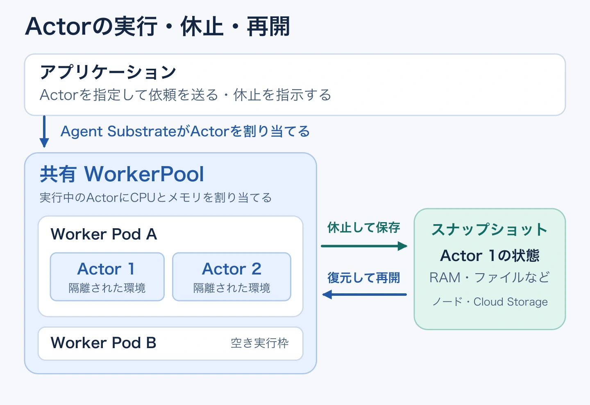
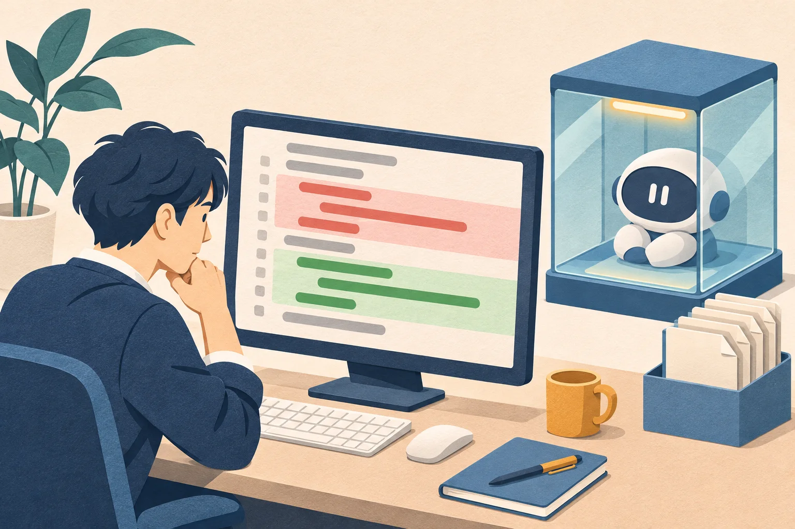
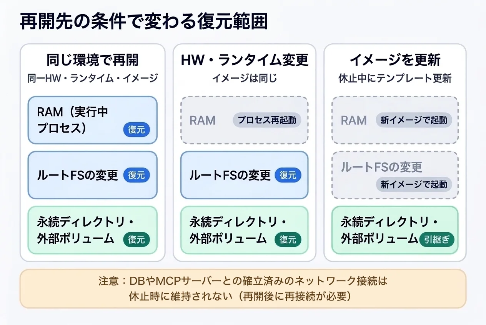
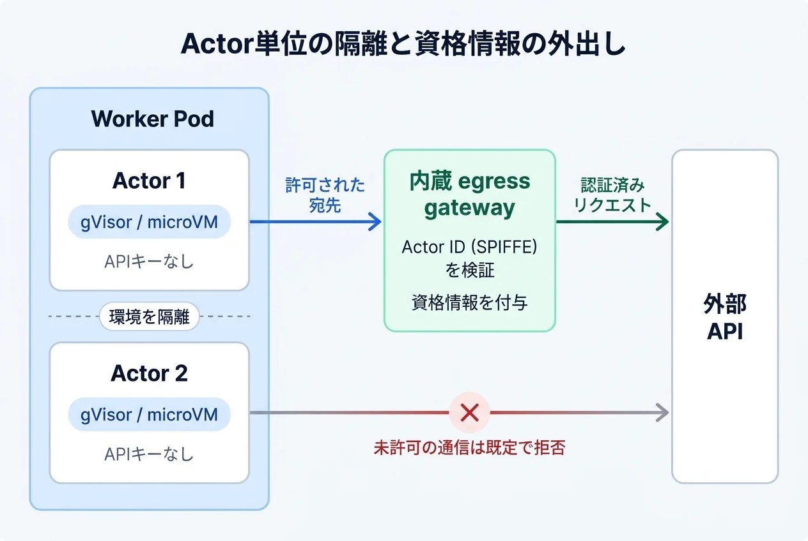
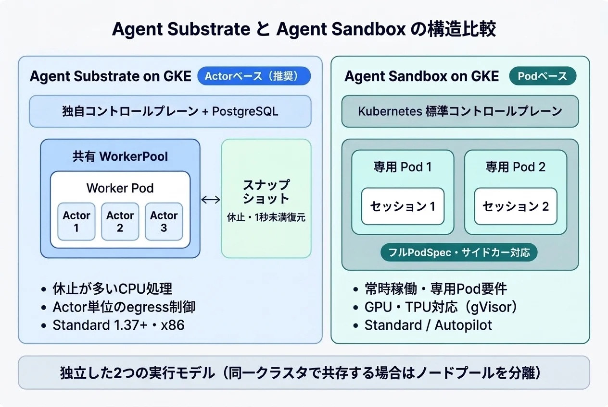

コーディングエージェントがコードを修正し、テストを終えて、こちらのレビューを待っている場面を想像してみる。差分を読んでいる間、エージェントは新しい作業をしていない。それでも、プロセスを維持すればメモリを占有し続ける。次の依頼まで環境を終了するなら、再起動したプロセスがどの状態から作業を続けるかを考える必要がある。

Agent Substrateは、こうしたエージェントのセッションを休止し、必要なときに再開するためのオープンソースの実行基盤である。アプリケーションが休止を指示すると、Agent Substrateはそのセッションの状態を保存し、実行に使っていた資源を解放する。次の依頼を受けたときは、空いている実行枠で状態を復元する。

Google Cloudは2026年11月6日（米国時間11月5日）の[公式発表](https://cloud.google.com/blog/products/containers-kubernetes/open-infrastructure-for-autonomous-agents-comes-to-cncf)でAgent Substrate 1.0とGKE上でのGAを公表し、[GKEのリリースノート](https://docs.cloud.google.com/kubernetes-engine/docs/release-notes-new-features)にも11月9日付でGAが記載された。GKE向けの構成は、自分のGKE Standardクラスタにデプロイして使う。

## セッションをActorとして管理し、実行資源を共有する

Agent Substrateでは、エージェントのセッションを **Actor** として管理する。コンテナイメージや必要なCPU・メモリなどは **ActorTemplate** で定義する。

動いているActorの実行資源は、事前に起動したWorker Podの集合である **WorkerPool** から割り当てる。1つのWorker Podは、資源に余裕があれば、隔離された複数のActorをホストできる。

コードレビューの例に当てはめると、次のように動く。

1. アプリケーションが作業セッションに対応するActorを指定し、テストを実行するリクエストを送る。
2. Actorが処理を終える。アプリケーションはレビュー待ちに切り替えるタイミングで休止を指示する。
3. Agent SubstrateはActorの状態をスナップショットに保存し、空いた実行枠を別のActorに使えるようにする。
4. 開発者が追加の依頼を送ると、Agent Substrateは利用可能な実行枠でActorを復元してから、リクエストを届ける。

Worker Podが複数のセッションを受け持つので、各セッションが待機中も専用Podを確保しておく必要がなくなる。KubernetesはノードやWorker Podを管理し、Actorの割り当てと休止・復元はAgent Substrateが独自のコントロールプレーンとクラスタ内のPostgreSQLで扱う。どの時点なら安全に休止できるかは、アプリケーションやオーケストレーターが判断する。

## 復元できる状態は、再開先の環境で変わる

会話履歴をDBに保存して読み直す方法でも、次の依頼にそれまでの文脈を渡せる。Agent Substrateのスナップショットは、再開先が対応していれば、作業中のファイルに加えて実行中のプロセスのメモリも復元する。同じ手順でプロセスを起動し直したときには失われる、中間状態を引き継げるのが特徴だ。

ただし、DBセッションやMCPサーバーへの接続など、確立済みのネットワーク接続は休止時に維持されない。再開後の再接続はエージェント側で処理する必要がある。

| 再開時の条件 | 復元される状態 |
| --- | --- |
| ハードウェア、サンドボックスのランタイム、コンテナイメージが同じ | RAM、ルートファイルシステムの変更、永続化対象として設定したディレクトリ |
| ハードウェアまたはランタイムが変わり、イメージは同じ | ルートファイルシステムの変更と永続化対象のディレクトリ。プロセスは起動し直す |
| 休止中にActorTemplateのイメージを更新 | 永続化対象のディレクトリと外部ボリュームを引き継ぎ、新しいイメージで起動 |

たとえば、エージェントが作った差分をコンテナイメージの更新後も残したいなら、その作業ディレクトリを永続化対象として設定するか、外部ボリュームに置く。外部CSIボリュームのデータはスナップショットとは別に保存され、復元時に再接続される。

GKEで使える外部ストレージの選択肢には[Filestore agent volumes](https://docs.cloud.google.com/filestore/docs/agent-substrate)がある。2026年11月22日時点では利用に申請が必要で、Agent Substrateとの統合はPreviewである。

Google Cloudの発表では、利用可能なWorkerへの復元を500ms未満と説明しており、GKEの公式ドキュメントでは1秒未満と記載されている。実際の復元時間はスナップショットのサイズや実行枠の空きに左右される。利用者が追加依頼を送ってから応答を受け取るまでの時間には、復元に加えて、エージェントの処理やモデル呼び出しも含まれる。

## Actor単位で実行環境と外部アクセスを制御する

同じWorker Podで複数のActorを動かす場合も、Actorごとに実行環境を隔離する。ランタイムはgVisorまたはCloud Hypervisorを使うmicroVMである。gVisorはユーザー空間のカーネルを介してホストカーネルへのアクセスを制御し、microVMは仮想化による境界を設ける。

GKE向けのインストールではgVisorが既定だ。なお、Agent SubstrateはWorker Pod内で独自のランタイムを管理するため、Worker用のノードプールでGKE Sandboxを有効にしてはいけない（ノードにtaintが付与され、Worker Podがスケジュールされなくなる）。

外向きの通信は既定で拒否され、必要な宛先をActorのポリシーで許可する。認証が必要なAPIには、内蔵のegress gatewayが、許可したリクエストにActorのIDに応じた資格情報を加えられる。これにより、エージェントが動く環境にAPIキーを置かずに、必要なAPIを利用させられる。

ただし、通信先や資格情報の制御だけで業務上の安全性が完結するわけではない。たとえば読み取りと書き込みを分けたい場合は、接続先のAPI側でも権限を絞り、書き込みに人の承認が必要ならアプリケーション側で扱う。[Harness Engineeringの記事](/2026/09/22/harness-engineering/)で整理したとおり、権限管理や人間の承認フローを含めた実行基盤全体の設計が要になる。

## Agent Sandboxとの使い分け

GKEには、隔離した環境でエージェントを動かす方法として[Agent Sandbox](https://docs.cloud.google.com/kubernetes-engine/docs/concepts/machine-learning/agent-sandbox)もある。両者は依存関係や後継による置き換えではなく、GKE上で並存する独立した2つの実行モデルである。Agent SandboxはKubernetes SIG Apps発のPodベース構成（2026年11月12日にGKEでGA）、Agent SubstrateはCNCF Sandbox寄贈のActorベース構成であり、同一クラスタ内でもノードプールを分けて共存できる。

[GKEの公式設計ガイド](https://docs.cloud.google.com/kubernetes-engine/docs/concepts/machine-learning/agent-workloads)では、待機と処理を繰り返すCPU中心のセッションにはAgent Substrateを推奨しつつ、フルPodSpecやサイドカーを含む構成、GPU・TPU、GKE Autopilotが必要な場合はAgent Sandboxを選ぶ棲み分けになっている。

| 判断軸 | Agent Substrate on GKE | Agent Sandbox on GKE |
| --- | --- | --- |
| 実行の単位 | Actorを共有WorkerPoolに配置 | セッションごとに専用Pod |
| 適した処理 | 休止と再開を繰り返すCPU中心のセッション | 常時稼働するセッションや専用Podが必要な処理 |
| 休止と状態の保存 | 組み込みのスナップショット（gVisor・microVM対応、1秒未満で復元） | 休止時にPodを削除して永続ボリュームを保持。gVisor構成ではPodスナップショット（復元3〜5秒）も利用可能 |
| 認証・秘密情報管理 | Actor単位のSPIFFE ID・JWTと、egress gatewayでの資格情報注入 | PodのServiceAccount（WarmPool内で共有）とSecret・CSIマウント |
| GKEの構成 | Standard 1.37以降、x86のWorkerノード（E2など混在CPU非対応） | StandardとAutopilot。機能別の対応条件あり |
| GPU・TPU | 非対応 | 対応する機種・バージョンとgVisorの組み合わせで利用可能 |

## 導入前に確認したい条件と計測項目

Agent Substrateを導入するには、GKE Standardのコントロールプレーンとノードプールをともに1.37以降に揃え、E2のような混在CPUアーキテクチャのマシンシリーズは避ける（既存クラスタではGKE Dataplane V2と `c3-standard-4` 以上のノードが必要）。

既存クラスタでmicroVMを選ぶ場合は、ネストされた仮想化を有効にしたノードプールか、対応するx86ベアメタルノードを用意する。また、Extendedリリースチャンネルのクラスタや、永続ディスク容量が限られるCloud Shellからはインストーラを利用できない（詳細は[インストール要件](https://docs.cloud.google.com/kubernetes-engine/ai-ml/install-overview-substrate)を参照）。

設計面では、まずアプリケーションが休止を指示できる地点を決める。人がコード差分をレビューする数分間なら、処理を終えた時点を休止の候補にできる。前述のとおり休止すると確立済みのネットワーク接続は維持されないため、外部サービスの呼び出しをまたいで休止したい場合は、非同期の応答受け取りや再接続、再試行しても同じ操作が重複しない設計を確認する。

次に、ピーク時の同時稼働Actor数と、1秒あたりに何件の再開が集中するかを見積もる。同時稼働数はWorkerのCPU・メモリを、再開の集中とスナップショットの大きさはストレージの帯域を左右する。検証するなら、手元のワークスペースに近いサイズで、同じノード上のキャッシュから復元する場合と、Cloud Storageから取得する場合を分けて測ると、遅延の内訳が見える（計算式の目安は[インフラ設計ガイド](https://docs.cloud.google.com/kubernetes-engine/docs/how-to/design-substrate-infrastructure)にまとまっている）。

最後に、Actorが実行枠を返した時点と、ノード数を減らせる時点を分けて考える。解放された実行枠を別のActorが利用できても、ノードが稼働している間はその費用がかかる。

Agent Substrate自体に追加料金はなく、GKEのノード、制御用のPostgreSQLが使う永続ディスク（既定500 GiB）、スナップショット保存先のCloud Storageなど、構成したリソースに応じた費用が発生する。比較する際は、同じピーク負荷と再開時の応答目標を満たす構成同士で、ノード数とストレージ費用を見る。

## まず休止できる時間と復元対象から考える

まず見たいのは、レビュー待ちのように**休止できる時間がどれだけあるか**と、**次の依頼までに何を復元する必要があるか**である。

待機が長く、作業途中の状態を引き継ぐCPU中心のセッションなら、Agent Substrateを試す理由がある。専用Podやアクセラレータが前提なら、Agent Sandboxの対応条件から確認できる。

## 参考資料

- [Google Cloud Blog: Powering open infrastructure for autonomous agents（2026年11月6日 / 米国時間11月5日）](https://cloud.google.com/blog/products/containers-kubernetes/open-infrastructure-for-autonomous-agents-comes-to-cncf)
- [GKE release notes (new features)](https://docs.cloud.google.com/kubernetes-engine/docs/release-notes-new-features)
- [About Agent Substrate on GKE](https://docs.cloud.google.com/kubernetes-engine/ai-ml/about-agent-substrate)
- [Install Agent Substrate on GKE](https://docs.cloud.google.com/kubernetes-engine/ai-ml/install-overview-substrate)
- [Design your infrastructure for Agent Substrate on GKE](https://docs.cloud.google.com/kubernetes-engine/docs/how-to/design-substrate-infrastructure)
- [Plan an architecture for AI agent workloads on GKE](https://docs.cloud.google.com/kubernetes-engine/docs/concepts/machine-learning/agent-workloads)
- [About Agent Sandbox on GKE](https://docs.cloud.google.com/kubernetes-engine/docs/concepts/machine-learning/agent-sandbox)
- [Use Filestore agent volumes with GKE Agent Substrate](https://docs.cloud.google.com/filestore/docs/agent-substrate)

---

公式資料の確認日は2026年11月22日。本稿は公式資料に基づく構成の解説であり、実クラスタでの復元時間や費用は計測していない。
