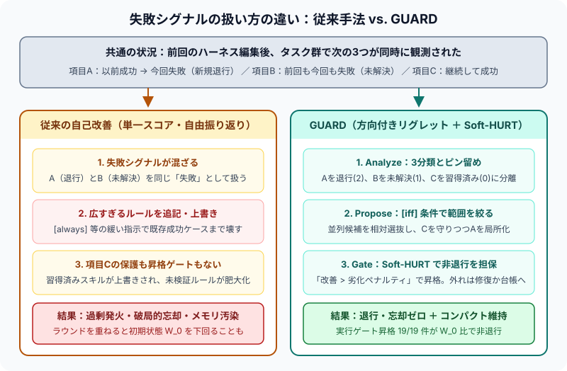
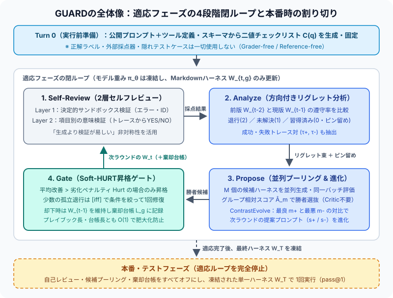

[Harness Engineeringの記事](/2026/09/22/harness-engineering/)で整理したとおり、AI Agentの実用品質はモデル単体の推論能力だけでなく、プロンプト、`SKILL.md`、`MEMORY.md`、ツール利用ルール、事前チェックを含むHarness全体の設計に左右される。実務では、ツール仕様や業務手順の変化に合わせてこのHarnessを継続的に更新する必要がある。

しかし、人手によるメンテナンスは失敗トレースの一部しか見られないため拡張しにくく、逆に正解ラベルや外部採点器（external grader）のない状態でAgent自身にHarnessを自己編集させ続けるRecursive Self-Improvement（RSI：再帰的自己改善）は、ラウンドを重ねるうちに初期状態より性能が落ちてしまうことが多い。

Google Cloudの研究チーム（Minghe Zhang, Xuetao Kang, Yifei Ming, Yanfei Chen, Han Yu, Yufan Zhuang, Chen-Yu Lee）が2026年11月17日に公開した論文 [GUARD: Stabilizing Recursive Self-Improvement with Regret Guidance](https://arxiv.org/abs/2611.23476) は、この問題に対する閉ループ型の解決策を提示している。GUARDは **Grader-free Unsupervised Environment Design [UED] with Adaptive Rule Distillation** の略である。

本稿では、実務者の視点からGUARDの設計と実験結果を要約し、自動自己改善の導入有無にかかわらず人間のHarness設計・CI評価運用に持ち帰れる教訓と、前提・限界を整理する。

## なぜAI Agentのハーネス自己改善は壊れるのか

論文が指摘する根本原因はシンプルだ。外部の正解データやテストケースがない環境で、自由形式の振り返り（verbal reflection）や合計スコアだけを頼りにHarnessを更新すると、次の**2つの異なる失敗シグナルが混同される**。

1. **直前のHarness編集によって新しく壊れた振る舞い（edit-induced regression）**
2. **そもそも初期状態から解けていない能力不足（unresolved capability gap）**

これは、[Agent評価の記事](/2026/09/22/agent-evaluation-debugging/)で扱った「合否スコアだけを見てもどこから壊れたか分からない」問題が、自己編集ループの中で増幅された状態に近い。2つのシグナルを区別せずに自己編集を繰り返すと、次の3つの失敗モードが発生する。

| 失敗モード | 起きる現象 | 実務上の影響 |
| --- | --- | --- |
| 局所過学習・過剰発火（Over-triggering） | 直近の失敗を直すために `[always]` のような広すぎるルールを追加する | それまで成功していた既存タスクの挙動を壊す |
| 破局的忘却（Catastrophic Forgetting） | タスク種別やツールの前提が切り替わる（ドリフトする）たびにルールを書き換える | 前のタスク群で獲得したスキルが上書きされて消える |
| メモリ汚染・肥大化（Memory Pollution & Bloat） | 未検証の指示や陳腐化・矛盾したルールが追記され続ける | プロンプトが肥大化し、精度も推論トークン効率も悪化する |



## GUARDの全体像：適応フェーズの閉ループと本番時の割り切り

GUARDは、モデルの重み（`π_θ`）を完全に凍結したまま、周囲のMarkdownファイル群（プレイブック、`SKILL.md`、`MEMORY.md`、事前チェック、例外ルール）からなるHarness状態 `W_{t,g}` だけを更新する。いわば**テキスト空間での非パラメトリックな方策最適化**であり、外部APIとして提供されるブラックボックスモデルでもそのまま動作する。

設計の着想元は強化学習の2つの枠組み——Unsupervised Environment Design（UED）の「リグレット（後悔）に基づくカリキュラム設計」と、Group Relative Policy Optimization（GRPO）の「価値ネットワークを使わないグループ内相対評価」——である。これを重み更新や正解ラベルなしに適用するため、GUARDは**適応フェーズ**と**本番（テスト）フェーズ**を明確に分ける。



本番実行時にリトライや多数決を走らせて精度を底上げするのではなく、**適応フェーズで検証済みのコンパクトなルールだけを蒸留し、本番では通常と同じ1パスで動かす**割り切りが特徴だ。

## ソリューションの核心：4つの技術的メカニズム

### 1. 実行前チェックリスト × 2層セルフレビュー

外部の正解採点器がない状態で、どうやって自己評価の信頼性を保つか。GUARDは「多制約を同時に満たしながら長い手順を生成するより、完了したトレースに対して制約を1つずつ確認するほうがはるかに易しい」という**生成と検証の非対称性**（generation-verification asymmetry）を利用する。

具体的には、タスク実行前（Turn 0）に公開プロンプト、ツール宣言、スキーマだけを入力として、タスク要件を原子的な二値チェック項目群 `C(q)` に分解・キャッシュしておく。そして実行後に2層で採点する。

- **Layer 1（決定的サンドボックス検証）**: サンドボックスの複製上で、実行エラーの有無、存在しないIDやカラム名の使用、状態変更の冪等性などをプログラム的に決定的検証する。致命的なサンドボックスエラーがあれば厳格スコア `S^strict` は即座に `0` になる。
- **Layer 2（意味的トレース検証）**: ツール実行トレースと最終応答を見ながら、事前登録されたチェック項目 `c` を1件ずつ YES/NO で検証する。

Hosted EvoHarnessBenchでの検証では、LLMだけの1層レビューは実行エラーを起こした失敗トレースの **22.2%（12/54件）** を75%以上の合格圏内として誤通過させており、LLM単独評価の楽観バイアスが表れていた。Layer 1を組み込むと定義上 `S^strict` が `0` に抑え込まれるため、2層レビューでの誤通過は **0.0%（0/23件）** になる（論文Table C.6でも構造上の動作確認・sanity checkとして区別されている）。そのうえで予測妥当性の独立した裏付けとなるのが、全4,059件のテストロールアウトを通じた集計である。Layer 1の通過群と失敗群の間で公式採点器による正答率に **+27.92pp（73.90% vs 45.97%、陰性的中率 82.6%）** の明確な分離が確認されている。

なお論文のTheorem 2では、全体の合否しか見ない受動的な学習では稀なルール違反（出現確率 `ε`）をすべて観測するのに `Ω((log J)/ε)` ラウンドかかるのに対し、実行前チェックリストによる密な採点を行えばこの `1/ε` のペナルティを取り除けることも示している。

### 2. 方向付きリグレットによる退行分離とピン留め（Analyze）

チェック項目ごとの遵守率 `obey(c; W) ∈ [0, 1]` を使って、Analyzeステージは直前のHarness `W_{t-2}` と現在のHarness `W_{t-1}` を同じタスク群で比較し、ハイパーパラメータなしの優先度を計算する。

```text
Δ_hurt,t(c) = max(0, obey(c; W_{t-2}) - obey(c; W_{t-1}))   # 直前の編集で新しく壊した分
Δ_gap,t(c)  = 1 - obey(c; W_{t-1})                          # 現時点の未解決ギャップ
Priority_t(c) = Δ_hurt,t(c) + Δ_gap,t(c)                    # 値域 [0, 2]
```

単一ロールアウト・二値判定の場合、優先度は `{2, 1, 0}` の3水準にきれいに分かれる。

| 分類 | 条件 | 単一試行時の優先度 | 次の編集での扱い |
| --- | --- | --- | --- |
| **Regressed（退行）** | `Δ_hurt,t(c) > 0` | **2（最優先）** | 既存ルールを削除せず `[iff <trigger>]` で発火条件を狭める対象 |
| **Unsolved Gap（未解決）** | `Δ_hurt,t(c) = 0` かつ `Δ_gap,t(c) > 0` | **1** | まだ満たせていない要件に対する手順やチェックを追加する対象 |
| **Mastered（習得済み）** | `Priority_t(c) = 0`（遵守率1かつ退行0） | **0（保護）** | **ピン留め（Pinning）** して上書き・改変を防ぐ対象 |

単なる失敗頻度 `1 - obey` を使うと新規の退行と昔からの未解決課題が区別できず、逆に単純な差分だけだと「ずっと解けていない項目（0 → 0）」と「習得済み項目（1 → 1）」が同じ `0` になってしまう。2つの非負項を足すだけの式は、この両方を同時に解消している（Proposition 1）。

なお、前ラウンドで変更案が棄却された場合（`W_{t-1} = W_{t-2}`）は、実行スコア評価において現版 `W_{t-1}` と棄却された勝者候補 `W̃_{t-1}`（またはその修復版）を比較して `Δ_hurt,t` を計算するため、連続棄却時に退行シグナルが消えてしまうのを防げる。さらに同一タスクでスコア差が開いた成功・失敗トレース対 `(τ+, τ-)` も抽出して提案器に渡す。5ドメインのEvoHarnessBenchローカル環境を用いた教師-生徒構成（`gemini-3.8-flash` 生徒＋ `claude-opus-5-5` 教師）のアブレーション実験では、このAnalyzeステージを外して `1 - obey` に置き換えただけで、安全ゲート（Soft-HURT）を残していてもマクロ平均精度が **-7.33pp（66.46% → 59.13%）** 低下し、初期ベースライン `W_0`（65.81%）すら下回った。

### 3. 並列候補プーリングと対照的メタプロンプト進化（Propose）

Proposeステージでは、ドメイン固有のヒントを含まない単一のシードプロンプト `s_0` から開始し、1ラウンドあたり `M >= 2` 個（主実験では主に `M = 2`）の候補ハーネスを並列生成する。

各候補を同一のタスクバッチで評価し、次のフィットネス `R_m` とグループ内標準化スコア `Â_m` で勝者を選ぶ。

```text
R_m = Perf_m - β * |Q-_m| + γ * |Q+_m|     (β = 3.5 > γ = 1.5)
Â_m = (R_m - μ_R) / σ_R
```

ここで `Perf_m = S̄^strict + 0.25 * S̄`、`Q-_m` は悪化したタスク集合、`Q+_m` は改善したタスク集合である。`β = 3.5` に対して `γ = 1.5` と設定することで、**1件のタスクを直す価値より1件のタスクを壊すペナルティのほうを重く罰している**。また同じバッチ上で候補同士を相対比較するため、タスク難易度のばらつきが相殺され、強化学習のCritic（価値ネットワーク）が不要になる。

さらに特徴的なのが **ContrastEvolve** だ。同ラウンド内の最良候補 `m+` と最悪候補 `m-` のプロンプト・プレイブック・結果（タスクIDは `<TASK_ID>` にマスク）を比較し、**「なぜ勝者が敗者を上回ったか」を言語化して、次ラウンドの提案用メタプロンプト自体を2種類に書き換える**。

- `s+`: 勝者の具体的なスコープ構造を伸ばし、ピン留めされたルールを守るプロンプト
- `s-`: 敗者の広すぎるトリガーを厳密な `[iff <precondition>]` に修正させるプロンプト

EvoHarnessBench ITSMでの統制アブレーション（単一Gemini 4、テスト132タスク × 3試行）では、総候補評価予算を `2T` に揃えた比較でも、並列プーリング（`M=2`, 81.08%）が逐次探索（`M=1, 2T`, 78.85%）を **+2.23pp（p = 0.0267）** 上回り、ゲート却下ラウンド数も **64% 削減（11回 → 4回）** している。

### 4. Soft-HURT昇格ゲート・`[iff]` 局所修復・棄却台帳（Gate）

候補が選ばれても、無条件には採用しない。従来の「ベストスコアから一定幅以内なら許容するスコアバンド型ゲート」は、微小な劣化が複数ラウンドで累積したり、平均点向上の裏で一部タスクの大きな退行を見逃したりする弱点があった。

GUARDの **Soft-HURTゲート** は、単一タスクのノイズ床（`δ_noise = 15` 点 / 100点満点）を超えて悪化したタスク集合 `Q-` について、対象グループ全体のタスク数 `|Q_g|` で割ったグループ平均の劣化ペナルティ `Hurt` を算出し、次の条件を満たすときだけ昇格させる（両辺に `|Q_g|` を掛ければ、グループ全体の改善合計が劣化合計を厳密に上回ることを意味する）。

```text
Promote ⇔ 平均スコア改善 (S̄(W_new) - S̄(W_prev)) > グループ平均の劣化ペナルティ Hurt(W_new, W_prev)
```

![Soft-HURT昇格ゲートと[iff]局所修復の判定フロー](../../../../../assets/diagrams/guard-soft-hurt-gate.svg)

さらに `|Q-| <= h_max`（許容悪化タスク数）を課し、悪化タスクが1件以上ある場合（`|Q-| > 0`）に限って改善タスクが少なくとも1件あり、かつ改善幅が `max(Hurt, μ_min)` を超えることを求める（悪化タスクが0件なら `μ_min` は課さず、修復後の再評価でも `μ_min = 0` を使う）。ここでユニークなのは、**わずかなタスクの孤立したリグレッションだけで落ちた場合、即座に捨てずにラウンド内で最大1回だけ `[iff]` 局所修復を試みる**点だ。問題となったルールの適用条件を `[iff <具体的な前提>]` に絞り込んで再実行し、Soft-HURTを通過すれば採用する。

それでも基準を満たさない候補は棄却して `W_{t-1}` を維持し、固定長ウィンドウ（`L_max` = 12〜40件）のJSONL台帳である **Rejection Ledger（棄却台帳）** に記録する。同じ失敗を丸ごと繰り返すのを防ぎつつ、プレイブック長 `B_W`（2,300〜4,200文字程度）とあわせて提案器のコンテキスト消費をラウンド数 `T` に対して **`O(1)`** に抑え込む。

同じ教師-生徒構成（`gemini-3.8-flash` ＋ `claude-opus-5-5`）の5ドメイン・アブレーションでSoft-HURTゲートを外して勝者を無条件昇格させると、マクロ平均精度は **-10.35pp（66.46% → 56.11%）** 急落し、5ドメイン中3ドメインが初期状態 `W_0` より悪化した。ITSMのステージ4では、存在しないMCPツール `get_current_user` を呼ぶ誤ったルールがそのまま通ってしまい、累積テスト精度が **7.61%** まで崩壊した事例も報告されている。

## 主要なベンチマーク結果

評価は「記憶と手順更新（PAST-Bench）」「進化するMCPツール・スキル（EvoHarnessBench）」「境界通知なしの継続ドリフト（Drift Gauntlet）」「法務・金融の専門推論（PRBench-Legal / Fin-Rate & Ledger）」の4領域で実施された。

実験は大きく2つのモデル構成に分かれる。EvoHarnessBench Hosted SDK、Drift Gauntlet、およびITSMのProposeアブレーションは、**より強い教師モデルを一切使わず単一の凍結されたGemini 4のみ**ですべての役割（実行・自己採点・ルール蒸留・メタ進化）を回している。一方、PAST-Bench主表・EvoHarnessBenchローカル5ドメイン・法務／金融の専門推論スイートは、**`gemini-3.8-flash`（生徒）と`claude-opus-5-5`（教師）による知識蒸留構成**で全手法を同一条件に揃えて比較した（PAST-Benchのみ完全単一モデル版も追加実施）。適応中はすべての参照回答・テストケース・評価ルーブリックを遮断し、テスト時は全プライマリベンチマークで単発実行（`pass@1`）を行う。

| ベンチマーク（主な設定・モデル構成） | 比較対象の課題・留意点 | GUARDの主な結果 |
| --- | --- | --- |
| **EvoHarnessBench Hosted SDK**（単一Gemini 4 / Calendar MCP v1〜v3 / 43テストタスク） | RRSI・GEPA・Meta-Harness・MemToolAgentはいずれもBWTまたはFWTが負に転落。`80.80%` は同一テストスプリット上の5構成中の最終値（5構成平均 `77.09%`, 範囲 `75.57–80.80%`, 全構成が他手法首位を上回る） | 精度 **80.80%**（`W_0` 71.91%比 **+8.89pp**, `p = 0.008`、GEPA比 `p = 0.023`、MemToolAgent比 `p = 0.010`、次点Meta-Harness 74.52%比は方向性優位 `p = 0.11` / 95% CI `[-0.4, +14.5]pp`）。完全解決率 **58.14%**（25/43）。負の転移ゼロの唯一のアーム（BWT Score +0.85pp / BWT Pass +2.56pp / FWT 0.00pp）。トークン消費 **-54.5%**（131,032 → 59,651） |
| **Drift Gauntlet**（単一Gemini 4 / 4種ドリフト・12ブロック遷移） | 他手法は12回の遷移中3〜8回で平均精度低下。可塑性と安定性に負の相関（`r = -0.82`）。なお総合安定性 `S` は未到達ブロックへの事前干渉（`I = -6.67pp`）の差でGEPA（`-0.35pp`）がGUARD（`-0.93pp`）を上回る | ストリーム平均低下 **0/12回**。全4ストリームでブロック後忘却 **0.00pp**。最高可塑性（+4.55pp）と最終平均精度首位（**73.22%**, `Δ_K = +3.30pp`、対GEPA差 `+0.82pp`＝360試行中約3問分）を両立。RRSIは67.92%で `W_0`（69.92%）を下回る |
| **PAST-Bench**（`flash + opus` 主表 / 12ファミリー・クロスセッション記憶・SOP更新） | 実行ゲートではなく4項目の単一パスcritic scoring（**24/24ラウンド全通過**でゲート選別なし）。追記型は更新が弱く（0.464〜0.529）、積極書換型は手順汚染率が **1.000** に悪化。単一Task指標のみGEPAが僅差首位（0.858 vs 0.854、Holm補正後の有意差なし） | 更新正確性 **0.924**、書込精度 **0.776**、メカニズム **0.878**、Evolve **0.436** で首位。多段SOPで精度83.0%・更新90.1%のまま**汚染 0.000**。純粋単一モデル（`claude-opus-5-5` でTask 0.870首位 / `gemini-3.8-flash` で0.371→0.852）でも優位性を維持 |
| **専門推論 & 実行ゲート忠実度横断**（専門2スイートは `flash + opus` / 実行ゲート付き3スイート横断） | ゲートなしや単なる振り返りは後半ラウンドでルール衝突による退行を起こす。ここでの非退行判定は**初期状態 `W_0` との比較**（`Δ_test >= 0`、直前版比ではない） | 全実行ゲート付きスイートの昇格 **19/19件すべて**が初期状態 `W_0` 比で非退行（15件改善、4件が `0.00pp` タイ）。PRBench-Legal +7.19pp（66.67%, `p = 0.0251`, hurt 0）、Fin-Rate & Ledger +12.50pp（Official 50.00% / Uncapped 82.96%, `n = 16` で `p = 0.50`, hurt 0） |

実務面で特に目を引くのが、EvoHarnessBench Hosted SDKにおける**本番トークン削減**だ。GUARDの最終プレイブックは **2,315文字** と極めてコンパクトで（RRSIは10,013文字、MemToolAgentは6,989文字、GEPAは5,123文字、Meta-Harnessは4,538文字）、8ステップ上限の使い切りが **0/43件**（`W_0` は7/43件、他手法は6〜10/43件）まで減った。結果としてMCP呼び出し回数は **-22.5%**（14.47 → 11.21回）、タスクあたり推論トークンは **-54.5%** となり、100万トークンあたり解決タスク数はベースエージェントの **2.61倍（9.75 vs 3.73）** に達している。

一方で、トークン数とツール呼び出し回数が減っても**テスト時の平均レイテンシは `233.8s`（`W_0` は `221.6s`、+5.5%）と短縮されていない**（GEPAは `159.1s`、RRSIは `613.1s`）。推論コスト（トークン課金）の圧縮効果と応答時間・適応コストの損益分岐は分けて見積もる必要がある。

## 実務への示唆：人間のハーネス設計・運用に持ち帰れる5つの視点

GUARDの仕組み自体を自前実装しなくても、論文の知見と実験の観察結果は、私たちが日々書いているシステムプロンプト、`AGENTS.md`、`SKILL.md`、そしてCIでのAgent評価に直接活かせる。

### 1. 「壊れないルール」の書き方

論文の付録（Box B.4）には、`ContrastEvolve` がRound 1の1ステップだけで勝者・敗者候補の差から抽出した教訓がそのまま載っている。人間のプロンプト設計としても非常に示唆に富む内容だ。

- **トリガーは `[always]` にせず `[iff <具体的条件>]` で絞る**: 敗者候補は「リクエストが人・グループ・サービスに言及したら」「最終応答時に必ず」といった広すぎるトリガーを書き、既に解けていたタスクを壊していた。一方、勝者は具体的なツール呼び出し（例：`create_new_hr_case` 呼び出し直前）や明示的なフレーズにルールを紐づけていた。
- **終了時ルールに新規アクションを混ぜない**: 「未処理の書き込みが残っていたら返信前に実行せよ」といった最終応答フェーズの指示は、重複書き込みや余計な副作用を招く。終了時ルールは「何が成功で何が失敗かをどう解釈するか」の定義だけに留めるべきだ。
- **フォーマット・取得経路・デフォルト値を曖昧にしない**: 「解決済みID」のような曖昧な表現や勝手なデフォルト値・同義語マッピングは既存の正しい挙動を上書きする。「数値のservice idか表示名か」「どの参照ツールで取得したどのフィールドを使うか」を明記し、指定がなければツール既定値を保つ。
- **条件付き参照の順序とエラー復旧を局所化する**: 「まず存在確認し、無かった場合のみ前提情報を取得する」と順序を明示し、バリデーションエラー時のリカバリも「エラーで指摘されたフィールドだけ直して再試行する」と狭く保つ。

実際に付録Box C.1で昇格したプレイブックルールは、次のように「いつ発火するか（`[iff ...]`）」と「何をするか」を1セットで極限まで絞って記述している。

```text
[iff the prompt or Evidence expresses year or date predicates such as YEAR(col) = YYYY in a SQLite environment]
Replace unsupported YEAR() calls with valid SQLite date extraction (STRFTIME('%Y', col) = 'YYYY' or col LIKE 'YYYY%') and enforce the year filter on every date column specified in the Evidence.
```

### 2. ハーネス変更のCI評価で「改善」と「退行」を分離する

プロンプトや `SKILL.md` を改修してCIで回帰テストを回す際、全体の平均スコアが上がったからといってそのままマージすると、特定の業務パターンがサイレントに壊れることがある。

Soft-HURTの思想を人間のCIレビューに翻訳するなら、**「全体改善幅（Lift）」と「既存成功ケースの劣化ペナルティ（Hurt）」を分けて集計し、新規に壊れたケース（`Δ_hurt`）を最優先でトリアージする**運用が有効だ。また、リグレッションが出たときに追加ルールを丸ごとボツにするのではなく、「発火条件を `[iff]` で狭めれば既存ケースを壊さずに新課題だけ直せないか」と考えるアプローチも実務向きである。

### 3. LLM-as-a-Judge 単独を避け、決定的な Layer 1 を前段に置く

単一のLLM審査だけで自己評価させると実行エラー付きトレースの22.2%を通過させてしまい、逆にLayer 1の機械検証で4,059件のテストロールアウト全体において公式正答率が +27.92pp きれいに分離できたという結果は、実務のAgent評価でも重く受け止めたい。

ツールの終了コード、DBやサンドボックスの状態変化、スキーマや必須引数の妥当性など、機械的に検証できる項目は必ず決定的なLayer 1で先に落とし、LLMによる意味判定（Layer 2）は「単一の二値チェック項目が実行トレース上の証拠と照らして満たされたか」に絞るほうが、誤通過（False Positive）を大幅に減らせる。

### 4. 「ルール追記による肥大化」は精度だけでなく推論コストも蝕む

不具合が見つかるたびに `AGENTS.md` やスキル定義へ注意書きを追記していくと、コンテキストが膨らむだけでなく、余計なツール探索やループを誘発してステップ数・トークン消費量が跳ね上がる。

GUARDが2,315文字のコンパクトなプレイブックでステップ上限到達をゼロにし、本番トークンを54.5%削減した事実は、「**ハーネスにサイズ上限を設け、使われていないルールや広すぎるルールを削ることは、精度対策であると同時に最も効く推論コスト削減策でもある**」ことを裏付けている。

### 5. 自動自己改善を本番へ持ち込むなら「永続プロンプト汚染」を前提に統制する

GUARDは未検証ルールによる性能劣化（Memory Pollution）は防ぐものの、「エージェントが自分自身の永続ハーネスを書き換える」構成にはセキュリティ上の論点も残る。もし本番ユーザーの悪意ある入力や外部データのプロンプトインジェクションを含んだ失敗トレースをそのまま適応ループへ流せば、不正な指示や情報漏洩を誘発するルールが `W_t` に定着する**永続プロンプト汚染**（Persistent Poisoning）のリスクが生じる。

実務で自己進化ループを運用する場合は、①適応対象ログを信頼できるデータやサニタイズ済みコーパスに限定すること、②本番は凍結済み `W_T` のみを参照し、Soft-HURTゲートを通過した候補もそのまま自動デプロイせず**人間のPRレビューを昇格ゲートとして挟む**ことが現実的な統制ラインになる。

## 導入・評価する上で押さえておきたい前提と限界

論文の主張を過大評価しないためにも、設計上の前提と限界を整理しておく。

- **「Grader-free」は完全無監督ではない**: 著者らも§2で明言しているとおり、正解ラベルを使わない代わりに、①公開タスクプロンプト、②公開ツールスキーマ、③サンドボックス上で観測可能な実行状態、④チェックリスト生成と検証を担える基盤モデル（主実験はGemini 4）の4つの構造に依存している。副作用をサンドボックスへ隔離・再実行しにくい本番外部API中心の業務では、Layer 1の構築自体が相応のコストになる。
- **適応フェーズの計算コストと損益分岐**: 本番推論は `pass@1` で軽いが、適応フェーズでは1ラウンドごとに `M` 個の並列ロールアウト（`O(TMQ)`）と項目別のLayer 2検証（`O(TMQC)`）が走る。さらにHosted EvoHarnessBenchのようにステージごとにタスクを累積追加して再評価する設定では、総ロールアウト数が `O(T^2 M q)` へ膨らむ（付録B.5）。上述のとおりテスト時レイテンシ自体は横ばいのため、適応時のLLM／サンドボックス費用を本番の大量トラフィックでのトークン削減で回収できるかが実務上の損益分岐になる。
- **安全側に倒す強い保守性と緩やかな改善幅**: 「壊さない」性質と表裏一体だが、Soft-HURTゲートは非常に保守的だ。Hosted EvoHarnessBenchではStage v1採用後にv2・v3が棄権（昇格見送り）となり、Local 5-domain全体（`flash + opus`、16ステージ中12棄却）でもマクロ平均の改善は `65.81% → 66.46%`（`+0.65pp`、CalendarとDriveは棄権で `W_0` 維持、HRはv1昇格後にv2環境シフト再検査で `W_0` へロールバック）に留まる。Drift Gauntletの対立ドリフト（`BFCL-Miss` → `BFCL-Base`）で後続書き換えを棄却した例や、Fin-Rate & Ledger（`n=16`）で `ledger` が 62.50% → 87.50% に伸びた一方 `fin_rate` が 12.50% のまま据え置かれた例（95% CI `[+0.00, +31.25]`, `p = 0.50`）を含め、既存スキルを捨ててでも新方針へ全面移行したい場面には向きにくい。
- **理論保証の適用対象とインターフェース署名ルーティング**: Theorem 1が保証する「下向きドリフトゼロ」は、あくまで各ラウンドの**ゲート対象バッファ上のセルフレビュースコア**に対する性質であり、未知のテスト分布への汎化は2層セルフレビューの較正精度に依存する（実証上は実行ゲート付きスイート19/19で初期状態 `W_0` 比の非退行）。またDrift Gauntletでは実行前に観測可能な環境・DBスキーマ署名（`bfcl`, `sciworld`, `bird:<db_id>`）ごとにプレイブックの節を分けるルーティングを併用しているが、論文は対照実験も行っており、**ルーティングを外した単一グローバルプレイブック版のGUARDでも忘却0.00pp・総改善の74%を維持し、逆にベースライン（GEPA・Meta-Harness）へ同じルーティングを与えてもGUARDが上回る**ことを確認している。
- **リファレンス実装の公開状況**: 付録B.3の記述時点では、ハーネス実装・実行前チェックリスト自己評価器・プロンプトテンプレートの公開は「承認待ちで公開予定（subject to approval）」とされており、コード一式はまだリポジトリ公開されていない（主要プロンプトの骨格やハイパーパラメータは付録B.3〜B.4に記載されている）。

## まとめ

GUARDが示したのは、AI Agentの自己改善を安定させる鍵が「賢い振り返りプロンプト」ではなく、**リグレッション分離（`Δ_hurt` と `Δ_gap`）、適用条件の厳格な限定（`[iff]`）、決定的検証を組み合わせた非対称レビュー、そしてSoft-HURTによる非退行ゲート**という、ソフトウェアエンジニアリング的な統制ループにあるということだ。

自律進化ループを本番にそのまま組み込む段階に至る前でも、「既存成功ケースを壊さない条件の書き方」と「改善と退行を分ける評価設計」は、今日のHarness Engineeringの実務にすぐ取り入れられる視点である。

## 参考資料

- [GUARD: Stabilizing Recursive Self-Improvement with Regret Guidance（arXiv:2611.23476 Abstract）](https://arxiv.org/abs/2611.23476)
- [arXiv PDF（2611.23476）](https://arxiv.org/pdf/2611.23476)
- [arXiv HTML（2611.23476v1）](https://arxiv.org/html/2611.23476v1)
- [AI Agentの品質はモデルだけでは決まらない — Harness Engineeringとは何か](/2026/09/22/harness-engineering/)
- [AI Agentの評価を「スコアリング」から「デバッグ」へ — どこで最初に壊れたかを評価する](/2026/09/22/agent-evaluation-debugging/)

---

論文の確認日は2026年11月24日（arXiv:2611.23476v1、2026年11月17日公開）。本稿は論文および付録の記述に基づく要約・考察であり、著者らによるベンチマークの再実行や独自環境での計測は行っていない。
