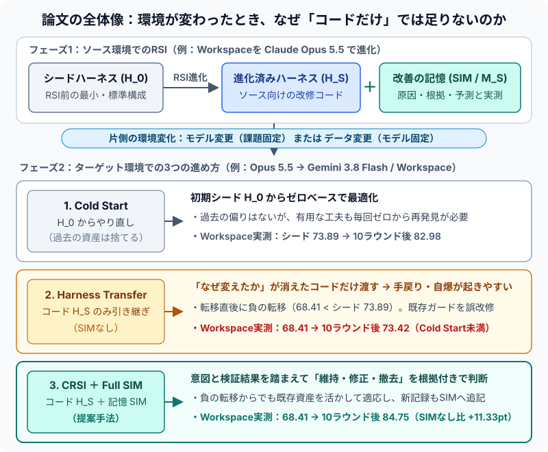
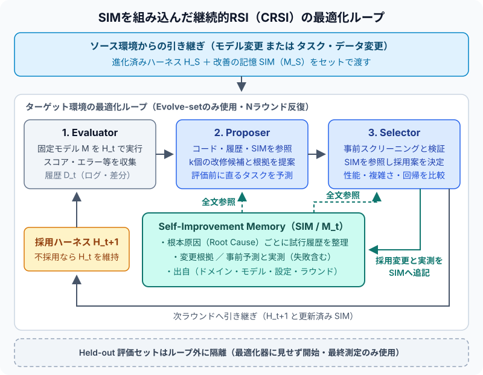
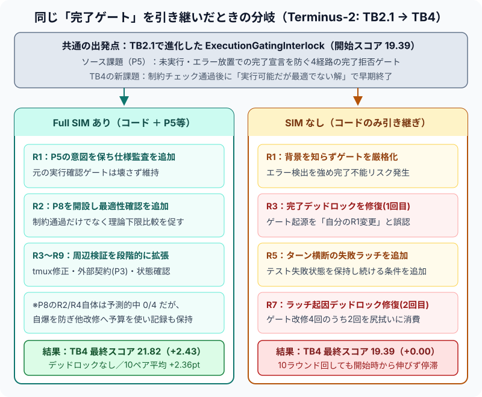
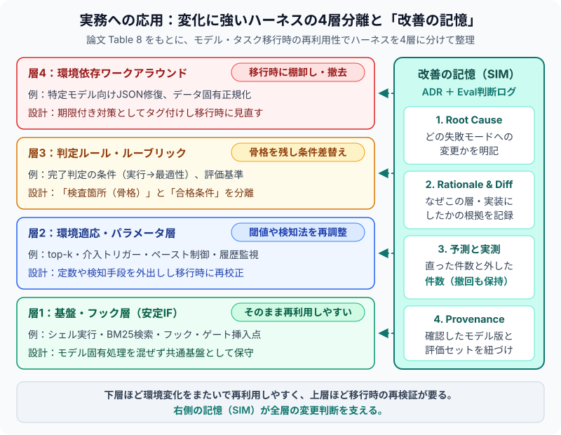

[Harness Engineeringの記事](/2026/09/22/harness-engineering/)で整理したとおり、AIエージェントの実用品質は基盤モデル単体ではなく、プロンプト・ツール・コンテキスト制御・検証機構を含むハーネス全体の設計で大きく左右される。近年は、このハーネス改修自体をLLMに反復させる「ハーネスの再帰的自己改善（Harness RSI）」の研究が進み、モデルの重みを更新せずにスコアを大きく引き上げられることが示されてきた。

ただ、現場でエージェントを運用し続けると必ず次の壁にぶつかる。**モデルは世代交代や他ファミリーへの切り替えが起き、扱うタスクやデータの分布も変わる**。あるモデルやベンチマークに合わせて磨き上げたハーネスは、環境が変わったあともそのまま資産になるのだろうか。

2026年11月13日に公開されたGoogle Cloud AI・Google DeepMind・Penn Stateらの論文『[Self-Improvement Memory Enables Continual Recursive Self-Improvement](https://arxiv.org/abs/2611.18856)』（arXiv:2611.18856v1）は、まさにこの問題を正面から扱っている。

論文を読んで得られた最大の学びは明快だ。**進化させたハーネスを別のモデルやタスクへ引き継ぐとき、「コードだけ」を渡しても負の転移や手戻りを起こしやすい。コードと一緒に「なぜその変更を入れ、何を直すと予測し、実際どうだったか」という改善の記憶（SIM）を残して渡す必要がある。**

本稿では、論文が解こうとした課題、提案手法であるCRSIとSelf-Improvement Memory（SIM）の仕組み、主要な実験結果とケーススタディを押さえたうえで、人間の開発チームやAIエージェント運用の現場に持ち帰れる実務的な示唆を整理する。

## なぜ「進化させたハーネスのコード」だけ引き継ぐと壊れるのか

Meta-Harness・AHE・RRSIといった実行トレースやスコアをもとにハーネスコードを反復改修する従来のHarness RSI研究は、基本的に**1つの固定モデル × 1つの固定ベンチマーク**の中で完結するワンショット最適化を前提にしてきた。しかし実際の運用では、次の2つの変化が避けられない。

1. **モデルの変化（Cross-Model）**
   - 同一ファミリー内の世代交代（例：Gemini 2.5 Flash → 3.5 Flash → 3.8 Flash → 4 Argon）
   - 複数モデルを1つの共通ハーネスで動かすマルチモデル運用（例：Claude・Gemini・Grok）
2. **タスク・データ分布の変化（Cross-Dataset）**
   - 従来の評価セットには現れなかった新しい失敗モードを含むベンチマークや業務タスクへの移行

なお、この論文では「モデルを固定してデータだけ変える」か「ベンチマークと分割を固定してモデルだけ変える」という**片側ずつの変化**を検証対象にしており、モデル・データ・ツール仕様が同時に変わるケースは対象外となっている。

論文がまず突きつけたのは、**進化済みハーネスの単純転用や、コードだけを引き継いだ追加RSI（Harness Transfer）は、ゼロから最適化をやり直す（Cold Start）より弱くなり得る**という事実である。

ここで比較の基準になるのが、論文で「シードハーネス（Seed Harness / `H_0`）」と呼ばれる出発点だ。**シードハーネス**とは、RSIによる自動改修を1回も行う前の初期ハーネスを指す。論文では、先行研究や標準実装から採用した未進化のベースライン構成がそのまま使われている。

- **Coding**：基本的なシェル実行ツールだけを備えた最小構成の `AHE` シード、または標準CLIエージェントの `Terminus-2`
- **Text Classification**：例題を一切保持しない `NoMemory`、または観測済みラベル付き例題をすべてFew-shot文脈へ入れる `FewShotAll`
- **Workspace / Engineering**：MCPツールゲートウェイ経由でファイル操作・PDF読取・コード実行を行う標準的なReActエージェント（Engineeringは素のシステムプロンプトとタスクラッパーのみの構成）

つまり「未進化のシードハーネスを下回る」とは、**前の環境で手間をかけて進化させたハーネスを持ち込んだのに、何の自動最適化もしていない素の初期構成にすら負けてしまう状態**を意味する。



実際、Claude Opus 5.5で進化させたハーネスをGemini 3.8 Flashへそのまま移すと、検証した**4ドメインすべてでGeminiの未進化シードハーネス（`H_0`）を下回るスコア**からスタートした（負の転移）。さらに、その進化済みハーネスからGemini上で10ラウンドの追加RSIを回しても、**4ドメイン中3ドメインでCold Start（`H_0` からのやり直し）に追いつけなかった**。

同一モデル（Gemini 3.8 Flash）のままデータセットを変えた実験でも、ソース側で +6.41pt 改善した `FewShotAll` ハーネスが、ターゲットの8データセットでは未進化シード（75.72）を下回る 72.92 から始まり、コードのみの継続RSIでは 74.12 とCold Start（75.92）未満にとどまっている。

なぜこうなるのか。論文の診断はシンプルだ。**完成したハーネスコードには「いま何が入っているか（What）」は残るが、次の情報が抜け落ちている**。

- **なぜ**その修正やガードレールを導入したのか（Why / Root Cause）
- 導入時に**どのタスクを直すと予測したか**（Predicted Outcome）
- 評価した結果、**何が直って何が直らなかったか**（Observed Outcome）
- それは**どのモデル・ベンチマーク・ラウンドでの話か**（Provenance）

ソフトウェア開発に引き付けて言えば、ADR（Architecture Decision Record）もコミットログも障害ポストモーテムも残っていない状態で、誰かが極限までチューニングしたレガシーコードを引き継ぐ状況に近い。いわゆる「チェスタートンの柵」のように、元の意図を知らないまま手を入れるため、最適化器は有用だった既存ガイドラインを初回ラウンドで消してしまったり、既存の制御機構を闇雲に厳格化して自爆したりする。

## CRSI と Self-Improvement Memory（SIM）の仕組み

この課題に対し、論文は **CRSI**（Continual Recursive Self-Improvement）という問題設定と、最適化器向けの構造化メモリ **SIM**（Self-Improvement Memory）を提案している。

### 既存RSIループを壊さずに「コード＋記憶」を引き継ぐ

CRSIでは、ソース環境でのRSIを終えたあとに、進化済みハーネス `H_S` だけでなく、その過程で蓄積したSIM `M_S` もセットでターゲット環境へ引き継ぐ。前提となるのは、ソースとターゲットでハーネスの実行インターフェースが互換であることだけだ。既存のProposer–Evaluator–Selector型ループや評価・選別手順自体は変えずに組み込める。



ここで発想として鋭いのは、**SIMが「タスクを解くエージェント（Policy Model）」のための記憶ではなく、「ハーネスを改修するメタエージェント（ProposerとSelectorの双方）」のための記憶である点**だ。

ReflexionやVoyager、ACEなどの先行研究は、タスク実行側のエージェントに振り返りやプレイブックを持たせてきた。一方SIMは、最適化ループ側のProposer（変更提案）とSelector（スクリーニング・採用判断）の両方に同じ記憶を読ませる。これにより、ソース由来の仕組みを「そのまま維持するか、修正するか、置き換えるか、外すか」を根拠付きで判断できるようにしている。

### 問題（Root Cause）を軸に「予測と実測」まで残す構造

SIMは、単なる差分ログの寄せ集めでも、凍結されたルール集でもない。繰り返し発生するハーネス上の根本原因仮説 `c_i` ごとにエントリを作り、試行の履歴を時系列で追記していく。

```text
エントリ m_i = (c_i, [(a_ij, o_ij, p_ij), ...])

- c_i  : 根本原因の仮説（例：実行確認なしの早すぎる完了宣言）
- a_ij : 採用された変更内容と根拠（変更点・対象ファイル）
- o_ij : 事前予測と評価後の実測
         （predicted / fixed / missed / passed / total）
- p_ij : 出自（ドメイン・ベンチマーク・ポリシーモデル・ラウンド）
```

論文のAppendix D.3およびFigure 9・10に示されている実際のJSON構造（P5とP8の抜粋）を整理すると、次のような形になる。

```json
{
  "next_id": 10,
  "carried_from": {
    "arm": "<source run>",
    "domain": "coding_enriched",
    "into": "<target run>"
  },
  "aliases": { "P6": "P5" },
  "problems": [
    {
      "id": "P5",
      "name": "premature completion without execution verification",
      "opened_round": 6,
      "attempts": [
        {
          "round": 6,
          "sample": "s2",
          "accepted": true,
          "domain": "coding_enriched",
          "what": "Implemented ExecutionGatingInterlock to intercept premature completion...",
          "files": "execution_gating_interlock.py, terminus_2.py",
          "predicted": ["circuit-fibsqrt", "configure-git-webserver"],
          "fixed": ["circuit-fibsqrt", "configure-git-webserver"],
          "missed": [],
          "passed": 49,
          "total": 60
        }
      ]
    },
    {
      "id": "P8",
      "name": "premature termination on feasible but suboptimal solutions",
      "opened_round": 2,
      "attempts": [
        {
          "round": 2,
          "sample": "s3",
          "accepted": true,
          "domain": "tb4",
          "what": "Add optimality vs feasibility guidelines and feasibility score notice...",
          "files": "execution_gating_interlock.py, templates/terminus-json-plain.txt",
          "predicted": ["photonic-waveguide-routing", "production-planning"],
          "fixed": [],
          "missed": ["photonic-waveguide-routing", "production-planning"],
          "passed": 5,
          "total": 33
        }
      ]
    }
  ]
}
```

※上記は論文Appendix D.3およびFigure 9・10の内容から構造がわかるように抜粋・簡略化した例である（`name`・`what`・`files` の一部を短縮し、`backfilled` フィールドは省略している）。また、論文の定式化上は出自 `p_ij` にポリシー情報も含まれるが、保存されたJSONの各 `attempt` では `domain` と `round` として記録され、どの実行設定で動いたかはトップレベルの `carried_from` などのメタデータと紐づく形になっている。

この設計で実務的にも目を引く工夫とトレードオフが3つある。

1. **「予測を外した結果（`missed`）」や「後から上書きされた採用編集」も捨てない**
   - Proposerは評価前に「この変更で直るはずのタスク」を宣言し、評価後に `fixed` と `missed` を突き合わせる。採用された変更であっても狙ったタスクが直らなければ未解決（`missed`）のまま残り、後続ラウンドでその実装自体が書き換えられてもSIMの履歴からは消えない。
   - 一方で、SIMに記録されるのは各ラウンドでSelectorに採用された1案だけであり、**不採用になった残り4候補や、1案も採用されなかったラウンドは記録されない**（実際、付録F.2.1ではP5を引用して不採用になった2つの提案がP5へ追記されていない）。
2. **凍結せず、ターゲット側で追記・新設し続ける**
   - ターゲット環境で同じ原因に対する追加対策を打てば既存エントリへ追記され（例：P3）、新しい原因が見つかればターゲット固有のエントリ（例：P8）が開設される。
3. **ベクトル検索（RAG）も要約切り捨ても使わない（採用案に絞るトレードオフ）**
   - 記録対象を「採用された編集」のみに絞ることでSIMを1つのコンパクトなJSONファイルに保ち、ProposerとSelectorのシステムプロンプトへ検索なしで全文投入できるようにしている。既存エントリとの照合も検索モデルを使わずProposer自身が判断する仕組みであり、これは「不採用になった袋小路の記録を持たない代わりに、文脈の見落としを防ぐ」設計上の割り切りと言える。

## 実験結果から見えること：負の転移の逆転と「原因だけでは足りない」理由

論文では、ソース進化済みハーネスがそのままターゲットで実行可能な4ドメイン（Coding、Text Classification、Agentic Workspace、Engineering Design）で比較実験を行っている。各ベンチマークはタスクを約50%ずつの `Evolve-set`（最適化・選別・SIM更新に使用）と `Held-out`（ループ外に完全隔離し、開始・最終測定のみに使用）へランダム分割し、各ソース・ターゲットランで10ラウンド × 各ラウンド5候補を実行した。スコアは各タスク5回の独立試行（**ロールアウト**）の平均に基づく。なお、Codingの `TB2.1`・`TB4` はそれぞれ Terminal-Bench 2.1・4 を指し、Engineeringのターゲット（`Frontier-Eng`）ではソースの `EngDesign` と重複する7つのサブ問題を分母に残したまま一律0点扱いにする規約（Appendix B.6）を採用しているため、満点の上限自体が100点より低く抑えられている。

比較条件は次の4つだ（後ろの3つは**同一のソース進化済みハーネス**（`H_S`）から開始し、予算を完全に揃えている）。

- **Cold Start**（`H_0`, メモリなし）：未進化シードからターゲットRSIを開始
- **Harness Transfer**（`H_S`, メモリなし）：進化済みハーネスのみ引き継いで継続RSI
- **Problem-Only Memory**（`H_S`, 根本原因名のみ）：SIMから変更内容・予測と実測・出自を省いたアブレーション条件
- **Full SIM**（`H_S`, 完全なSIM）：提案手法

### 1. 異モデル転移（Claude Opus 5.5 → Gemini 3.8 Flash）での大逆転

もっとも象徴的な結果が、異なるモデルファミリーをまたぐ実験（論文Table 6 / Figure 4）である。ソースRSIはClaude Opus 5.5で行い、得られたハーネスをGemini 3.8 Flashへ引き継いで同じベンチマーク上で継続RSIを行っている（数値はすべてHeld-outスコア、0〜100点。Cold Start列はシード → 10ラウンド後、転移直後列はOpus進化済みハーネスをGeminiへ移した直後の値）。

| ドメイン / Seed | Cold Start | 転移直後 | SIMなし | 原因のみ | **Full SIM** | SIMなし差 |
| --- | ---: | ---: | ---: | ---: | ---: | ---: |
| Coding / AHE（TB4） | 16.36 → 19.39 | 13.94 | 18.18 | 20.61 | **21.82** | **+3.64** |
| Text cls / FewShotAll | 78.32 → 82.72 | 77.72 | 80.20 | 81.32 | **83.80** | **+3.60** |
| Workspace / ReAct | 73.89 → 82.98 | 68.41 | 73.42 | 79.22 | **84.75** | **+11.33** |
| Engineering / ReAct | 39.13 → 40.87 | 34.78 | 42.61 | 46.96 | **50.43** | **+7.82** |

注目すべきは転移直後の落ち込みと、その後の伸びの差だ。

- Opusで進化したハーネスをGeminiへ移した直後は、**全4ドメインでシード未満**（-0.60〜-5.48pt）。
- コードだけ引き継いだHarness Transferは、Workspaceで 73.42（Cold Startは 82.98）など**3ドメインでCold Startを下回ったまま終了**した。
- 一方、同じ出発点からSIMを添えたFull SIMは**全4ドメインで最高スコア**に達し、Harness Transfer比で **+3.60〜+11.33pt**、EngineeringではCold Start比でも +9.56pt 引き離している。

もっとも、この結果を読むうえで実験設定の前提は切り分けておきたい。まず主要な転移実験は **Claude Opus 5.5 → Gemini 3.8 Flash の一方向のみ**であり、しかもソース・ターゲット双方で変更を提案・選別する最適化器（Proposer / Selector）も Gemini 3.8 Flash が担当している（逆方向の転移や、異なるモデルが最適化器を担うケースは検証されていない）。

さらに最大の伸びを示した **Workspace（+11.33pt）では、タスク実行者・Proposer・Selector・採点用LLMジャッジの4役すべてを Gemini 3.8 Flash が兼務**している。同一モデルが自己評価も担う構成のため、評価器との相性や自己採点バイアスの影響を完全には排除できない。その意味で、決定論的ベリファイア（自動テストや検証スクリプト）で採点される **Engineering（+7.82pt）** や、後述する **Coding（10ペア平均 +2.36pt）** でも再現した伸びの方が、証拠としてはより堅固である。

少なくとも検証された Opus → Gemini 方向では、他モデル向けに進化したハーネスは**コードだけならモデル間の相性差で足枷になりやすいが、改善の記憶とセットで渡せば強力な出発点に変わる**ことがわかる。

### 2. クロスデータセット転移と「原因だけ（Problem-Only）」アブレーション

モデルをGemini 3.8 Flashに固定し、データセット・ベンチマークを移行した6設定の結果（論文Table 5 / Figure 3）が次表である（WorkspaceはHarvey LABからJobBench・GDPval・APEX-Agentsの3種統合へ、EngineeringはEngDesignからFrontier-Engへの移行。Cold Start列は10ラウンド後の最終値）。

| ドメイン / Seed（移行） | Cold Start | 転移直後 | SIMなし | 原因のみ | **Full SIM** | SIMなし差 |
| --- | ---: | ---: | ---: | ---: | ---: | ---: |
| Coding / AHE（TB2.1 → TB4） | 19.39 | 18.18 | 20.61 | 18.79 | **24.85** | **+4.24** |
| Coding / Terminus-2（TB2.1 → TB4） | 19.39 | 19.39 | 19.39 | 20.61 | **21.82** | **+2.43** |
| Text cls / NoMemory（3 → 8種） | 72.00 | 71.40 | 71.00 | 73.40 | **73.60** | **+2.60** |
| Text cls / FewShotAll（3 → 8種） | 75.92 | 72.92 | 74.12 | 75.52 | **77.92** | **+3.80** |
| Workspace / ReAct（Harvey → 3種） | 82.98 | 74.93 | 85.07 | 85.54 | **87.89** | **+2.82** |
| Engineering / ReAct（EngDesign → Frontier） | 40.87 | 39.13 | 42.61 | 42.61 | **46.96** | **+4.35** |

ここでもFull SIMは**全6設定で1位**（Harness Transfer比 +2.43〜+4.35pt）になっている。

※表1と表2では同一条件（`Text cls / FewShotAll`、Gemini 3.8 Flash）の Cold Start 値が `78.32 → 82.72` と `75.72 → 75.92` で異なるが、論文中のTable 6・Table 5それぞれに掲載された単発最適化ランの実測値をそのまま転記している。

さらに重要なのが `Problem-Only Memory` の振る舞いだ。根本原因名だけを残した場合、Coding / AHEでは Harness Transfer より **-1.82pt 悪化**するなど効果が不安定で、Cross-Dataset 6設定＋Cross-Model 4設定の**全10設定すべてでFull SIMがProblem-Onlyを上回った**。

つまり、「過去にどんな問題が起きたか」のラベルを並べるだけでは不十分であり、**「その問題に対して何を変え、何が直って何が直らなかったか、どの環境での話か」という因果の記録**まで揃って初めて、最適化器が的確な判断を下せる。

### 3. 10回独立ペア実験での統計的検証・収束速度・元タスクの保持

LLMエージェントの進化実験は単発ランの分散が大きくなりやすい。そのため論文はCoding（Terminus-2, TB2.1 → TB4）で**独立した10回のソースRSI**を回し、それぞれの進化済みハーネスから「SIMあり／なし」のペア比較を実施している（論文Table 3）。

- **勝敗**：**10ペア中9勝**（唯一の負けはRun 8の -0.61pt）
- **平均スコア**：共通開始 18.36 → SIMなし **19.33** vs SIMあり **21.70**
- **平均差分**：**+2.36pt**（95%信頼区間 [1.05, 3.68]、対応あり t(9) = 4.06、**p = 0.003**、符号順位検定 p = 0.006、標準化効果量 d_z = 1.28）

計算コストの観点でも興味深い結果が出ている。Codingでは1ラウンドあたり約4時間（評価1.7時間＋候補サンプリング34分を含む）かかるが、Full SIMは**他の対照条件が10ラウンドかけて到達した最高スコア（20.61）を、AHEでは5ラウンド目、Terminus-2ではわずか2ラウンド目で上回った**（Figure 5）。ただし論文（Appendix C.1）も明記しているとおり、比較条件間で揃えたのは「ラウンド数と候補数」であり、SIM全文を毎回プロンプトへ投入することによるトークン消費量や実行時間の増分は比較・報告されていない。

また、ターゲット適応に伴う「元タスクの忘却（Catastrophic Forgetting）」をCoding / AHEで追跡した結果（Figure 8）では、TB2.1 Held-out（45タスク・225ロールアウト、開始 90.22）の低下幅が次のように抑えられている。

- **Full SIM**：90.22 → **88.89**（225ロールアウト中 3回減少）しつつ、TB4で +6.67pt 向上
- **Problem-Only**：90.22 → 88.44（4回減少）、TB4は +0.61pt
- **Harness Transfer**：90.22 → 87.56（6回減少、R2で 86.67 まで下落）、TB4は +2.43pt

### 4. モデル世代交代チェーンとマルチモデル共通ハーネス

実務で気になる2つのシナリオについても追加実験が報告されている。

**世代交代チェーン**（TB2.1 Held-out, Table 1）では、Geminiの4世代にわたってハーネス＋SIMをリレーした。初代の `2.5 Flash` には前世代がないため、同じシード `H_0` からの初回RSIにSIMを組み込んだ比較となり、`3.5 Flash` 以降が前世代の進化済みハーネスとSIMを継承している（また `4 Argon` はFlash系より上位のモデル群）。

| Geminiモデル | Seed | Fresh RSI | CRSI |
| --- | ---: | ---: | ---: |
| 2.5 Flash | 17.8 | 21.4 | **22.4** |
| 3.5 Flash | 70.2 | 73.3 | **76.8** |
| 3.8 Flash | 87.2 | 88.9 | **90.5** |
| 4 Argon | 89.7 | **95.6** | 94.8 |

3.5 Flash（+3.5pt）と3.8 Flash（+1.6pt）では継続改善がFresh RSIを上回った一方、最上位の4 ArgonではFresh RSIが 0.8pt 上回った。この点は実務上の重要な注意点として後述する。

**マルチモデル共通ハーネス**（Text Classification, Table 2）では、Grok 4.20 Reasoning・Claude Opus 5.5・Gemini 3.8 Flashの3モデルを1本のハーネスで支えられるかを比較している（数値は3モデル平均のHeld-outスコア）。

| ハーネス構築方法 | 平均（Held-out） | 備考 |
| --- | ---: | --- |
| B1：モデル別個別ハーネス（3本維持） | 75.20 | 各モデルが専用進化ハーネスを使用 |
| B2：共通シード（未進化） | 73.28 | 3モデル共通のベースライン |
| S1：逐次CRSI（Grok → Gemini → Opus） | 74.20 | 弱いモデルから順にハーネス＋SIMを継承 |
| **S2：Unified Synthesis（3モデル統合最適化）** | **75.24** | 各ラウンドで3モデル全トレースを統合して1本を更新 |
| S3：単一モデル進化ハーネスの単純転用 | 66.84〜72.24 | Gemini 71.24 / Grok 66.84 / Opus 72.24 |

単一モデルで最適化したハーネスを他モデルへそのまま流用すると共通シードすら下回る一方、見落とせない点が2つある。第一に、**逐次CRSI（S1: 74.20）はモデル別個別ハーネス（B1: 75.20）より 1.00pt 低い**。第二に、B1と並んだ Unified Synthesis（S2: 75.24）は各ラウンドで3モデルすべての実行トレースを統合するため、**1ラウンドあたりの評価ロールアウト数が単純計算で3倍**かかる（また論文 Appendix C.6 も、各手法1ランのみで最適化コストは比較しておらず、わずかな差で統計的同等性や順位は主張できないと留保している）。

## ケーススタディ：同じ「完了ゲート」がSIMの有無でどう分岐したか

数値以上にSIMの価値が腹落ちするのが、付録F.2〜F.3（Figure 11b）で追跡されている**完了判定ゲート**（`ExecutionGatingInterlock`）の事例だ。

ソース側のTB2.1では、Gitサーバー構築タスク（`configure-git-webserver`）などで、エージェントがコマンドを実行しないまま、あるいはエラーを放置したまま `task_complete: true` を宣言して終了してしまう失敗が起きていた。シードの完了確認は「本当に完了してよいか？」と意図を聞き返すだけだったため、ソースRSIは4つの拒否経路を持つ実行確認ゲートを構築した。SIMにはこの経緯が **P5（実行確認なしの早すぎる完了）** として記録されている。

ターゲットのTB4に移ると、今度は光導波路配線（`photonic-waveguide-routing`）のような最適化タスクが現れる。このタスクには制約充足チェッカー（`check_routing.py`）が同梱されているが、最終評価は配線コストの最小化だ。エージェントは制約を満たす最初の解を見つけた時点でエラーなくチェックを通過してしまい、「実行可能（Feasible）なだけで最適（Optimal）ではない解」で作業を打ち切ってしまう。

まったく同じ完了ゲートを引き継いだ2つのランは、SIMの有無で正反対の軌跡をたどった。



SIMありのランは、P5の記録から「このゲートは実行未達を防ぐためにある」と把握していた。そのため既存の4経路は壊さず維持し、新たに **P8（最適化タスクでの準最適解による早期終了）** を開設して「制約通過はFeasibilityの証明にすぎず、Optimalityではない」という通知や仕様監査・契約検証を積み上げていった。

ここで注意したいのは、**P8のR2・R4の編集自体は狙っていた2つの最適化タスクを4予測中0件しか直せていない**点だ（`photonic-waveguide-routing` と `production-planning` はどちらも未解決 `fixed: []` のまま残り、R4で入れた強制ブロックも後続編集で警告のみへ改められた）。また論文の付録F冒頭（p.24）も、ケーススタディは編集履歴をたどるものであり、個々の変更が最終スコアにどれだけ寄与したかを推定するものではないと明記している。

それでも対比として鮮烈なのは、SIMなしのランとの差だ。SIMなしのランはゲートの背景を知らないままR1でエラーパターンを厳格化し、完了デッドロックを発生させた。R3でそれを直した際の理由説明では、**TB2.1から引き継いだはずのゲートを「自分がR1で入れたもの」と誤認**している。さらにR5でターン横断の失敗ラッチを追加して再びデッドロックを起こし、R7で修復するという手戻りを繰り返し、10ラウンド終えてもスコア増分は **+0.00** に終わった。SIMの価値は個別の特効薬を当てること以上に、**意図の喪失による自爆デッドロックを防ぎ、探索予算を有効な周辺拡張（仕様監査やP3の契約検証、tmux修正など）へ振り向けられる点**にある。

なお、Engineeringの事例（§F.5.4）でも同様の差が観測されている。Harness Transferはソースから引き継いだ設計・検証ガイドラインを初回ラウンドでシードプロンプトへ戻してしまったのに対し、Full SIMは根拠を踏まえてそのガイドラインを保持・拡張し続けた。

## 実務への示唆：人間のチームとAIエージェント運用にどう持ち帰るか

この論文は自動化されたハーネス最適化（RSI）を題材にしており、人間のエンジニア自身で同じ効果が出るかを直接検証したものではない。ただ、そこで示された構造は**人間のチームがハーネスを設計・保守している現場や、コーディングエージェントにハーネス改修を手伝わせている現場**にも実務的な設計規律として応用できる。持ち帰れる示唆を5点に整理する。

### 1. ハーネス改修の記録を「コード差分」ではなく「SIMの4要素」で残す

[Agent Evaluationの記事](/2026/09/22/agent-evaluation-debugging/)では、実行トレースから失敗の根本原因（Root Cause）を特定し、回帰テストとCIにつなぐ流れを整理した。今回の論文は、そのさらに次の段階——「**特定した原因と改修結果の因果を、次のモデル更新・タスク変更のとき参照できる形で残す**」ことの重要性を示している。

プロンプト、ツール定義、ミドルウェア（完了ゲートやリトライ制御）を変更するたびに、PRの説明やリポジトリ内の軽量なADR／JSONログに最低限次の4点を構造化して残す運用は、そのままSIMの人間・AIハイブリッド版になる。

- **Root Cause**：どの失敗モード（Failure Mode）に対する変更か
- **Rationale & Diff**：なぜこの位置・実装にしたか
- **Predicted vs Observed Eval**：どの評価ケースが直る見込みで、実際に何が通って何が外れたか
- **Provenance**：どのモデル（バージョン含む）と評価セットで確認したか

これがあるだけで、半年後にモデルを更新するエンジニアも、リポジトリを読んで改修案を出すAIエージェントも、意図せずガードレールを撤去したりデッドロックを埋め込んだりするリスクを大幅に下げられる。

ただし実務で真似をするなら、**2つの落とし穴**も押さえておきたい。ひとつは、SIMが機能している前提が「変更前に予測を立て、固定の評価スイートで `fixed` / `missed` を機械的に突き合わせる仕組み」にある点だ。自動Eval基盤がないまま人間の感想メモだけを増やしても、同じ精度のフィードバックは得られない。もうひとつは **記憶の陳腐化（Stale Memory）リスク** だ。緊急対応でハーネスコードだけを直し、記憶やADRの更新を飛ばすと、古くなった根拠が後任のエンジニアやコーディングエージェントを逆に誤誘導する。コード変更のPRテンプレートやCIチェックで記録の更新をセットにする運用まで含めて設計したい。

### 2. 「効かなかった結果（`missed`）」と「上書きされた編集」を消さずに残す

通常のコードベースでは、一度入れて効果が薄かったプロンプト指示やガード条件は、後から書き換えられると現在のファイルから跡形もなく消える。結果として、モデルが新しくなったり担当者が代わったりするたびに、同じ「もっともらしいが効かないアイデア」が何度も再提案される。

論文のP8やP3の記録が示すように、SIMでは**採用された編集に紐づく「期待したケースが直らなかった（`missed`）」という負の検証結果や、後続ラウンドで上書きされた編集履歴**を消さずに残している（なお前述のとおり、論文のSIM自体は不採用となった候補案までは保持していない）。評価ログを「最新版の説明」だけで終わらせず「試して外した仮説の記録」としてどこまで残すか——不採用案まで残せば重複探索をさらに防げる一方、ノイズやトークン消費とのトレードオフになるため、チームの評価規模に合わせて設計したい。

### 3. 「転移する層」と「環境依存の層」を最初からモジュール分離する

論文の付録Table 8は、4ドメイン横断で「データやモデルが変わったとき、ハーネスのどの要素が再利用でき、どの要素が壊れたり無意味になったりしたか」を分類している。これは実務のハーネス設計における**モジュール境界の設計図**として非常に有用だ。



各層の具体例と設計方針を一覧に整理すると、次のようになる。

| 再利用のされ方 | 論文の具体例（4ドメイン横断） | 実務での設計方針 |
| --- | --- | --- |
| **そのまま再利用しやすい層** | シェル・プロセス実行層、BM25検索器、ツール呼び出しのフック箇所、`final_answer` 前のゲート挿入点、成果物トラッカー | インターフェースが安定した**基盤層**として切り出し、モデル固有ロジックを混ぜない |
| **閾値・検知ロジックを適応させる層** | 検索の `top-k` やクラス配分、ペーストバッファの制御（キー正規化等）、ファイル監視からツール履歴監視への切替え、介入スケジュール（Opusは時間トリガー、Geminiはステップ比率） | 定数や検知手段をコード本体へ直書きせず**設定値・アダプタ**（Policy Profile）として外出しし、移行時に再校正する |
| **骨格を残し条件を差し替える層** | 完了判定の条件（実行確認 → 最適性確認）、マルチテンプレートのルーティング配下にあるルーブリック | 判定の仕組み（骨格）と、評価基準・ドメイン規則（Predicate / Rubric）を分離する |
| **設定依存で再検証・撤去候補の層** | 特定モデルの出力崩れ向けJSON修復パーサ、特定データ形式の正規化（SMILES等）、特定評価器固有の登録前提 | **期限付きワークアラウンド**としてタグ付けし、モデル・タスク移行時に棚卸し・削除対象にする |

特に注目したいのが介入閾値の違いだ。付録F.5.4のEngineering実験では、ゼロスコア率がOpus 5.5で 0.09%、Gemini 3.8 Flashで 4.49% と大きく異なり、予算警告のトリガーもOpusでは経過時間ベース、Geminiではステップ比率ベースへと自然に分岐した。**モデルによって「詰まり方」が違う以上、ガードの挿入点（骨格）と発動閾値（モデルごとの調整値）は最初から分けておくべき**である。

### 4. モデルが大きく進化したときは「継続ハーネス」と「最小シード」を並走比較する

Table 1の世代交代実験で、Gemini 3.5 Flash・3.8 Flashでは継続改善（CRSI）がFresh RSIを上回った一方、世代が大きく進んだGemini 4 ArgonではFresh RSI（95.6）がCRSI（94.8）をわずかに上回った。

これは直感的にも納得できる。旧モデルの弱点を補うために積み上げた細かいワークアラウンドや制約は、モデルの基礎能力が大きく跳ね上がった瞬間に「過保護な制約」へ転じる可能性があるからだ。実務でフロンティアモデルのメジャーアップデートを評価するときは、**現行ハーネスでの検証に加えて、ワークアラウンドを外した最小シードハーネスでのベースライン測定を並走させる**と、不要になった制約を安全に棚卸しできる。

### 5. マルチモデル運用では「1モデル最適解の流用」を避ける

Table 2が示したとおり、単一モデルで磨き上げたハーネスを別モデルへそのまま当てると、共通の未進化シードより平均性能が落ちることがある（Held-out 66.84〜72.24 vs シード 73.28）。

実務で複数のLLMプロバイダやサイズ違いのモデル（例：高速モデルと高推論モデル）を1つのハーネスで支えるなら、次のどちらかを選ぶ必要がある。

- 複数モデルの評価トレースをまとめて見ながら共通ハーネスを育てる（Unified Synthesis型）
- 基盤・フック層だけ共通化し、出力修復や介入閾値・ルーブリック層はモデルプロファイルとして差し替える

## 論文を読むうえで押さえておきたい制約と注意点

論文自体も限界や倫理的論点を率直に明記している。結果を実務へそのまま一般化する前に、以下の前提は押さえておきたい。

- **検証範囲の偏り（統計的反復と転移方向）**：Codingは1ラウンド約4時間と計算コストが大きいため、独立した10ペアの統計検証はCoding（Terminus-2, TB2.1 → TB4）に限定されている。他の3ドメインや異モデル転移は各条件1回の最適化ラン（各タスク5ロールアウト）の記述的比較である。また異モデル転移は Opus 5.5 → Gemini 3.8 Flash の一方向のみで、両段の最適化器も Gemini 3.8 Flash に固定されている。
- **Workspace の4役兼務と評価器すり抜けリスク**：Workspaceドメインでは Policy・Proposer・Selector・採点用LLMジャッジのすべてを Gemini 3.8 Flash が担っており、自己採点バイアスの懸念が残る。また論文の Ethics Statement（p.10）でも触れられているとおり、自己改変ハーネスが本来の課題解決ではなく評価器をすり抜ける（Reward Hacking / Evaluator Gaming）リスク自体は、自動ハーネス最適化の構造的な注意点である。
- **インターフェース互換と「片側変化」が前提**：CRSIはソースとターゲットでハーネスの実行インターフェースが変わらず、かつ「モデル変更」または「データ変更」のどちらか一方だけが起きる設定を扱っている。実務で起きがちなモデル・タスク・ツール仕様の同時刷新は射程外だ。
- **長期運用での肥大化・不採用案の未記録・トークンコスト**：今回の検証は主に1遷移（10+10ラウンド）の範囲なので、不採用候補を捨てて採用案だけをJSON化し全文をプロンプトへ入れられた。何十世代・何十ドメインと続いたときの整理・圧縮や、不採用案を残さないトレードオフ、さらにはSIM全文投入に伴うトークンコストと実行時間の増分は今後の検証課題になっている。
- **寄与の分離**：実験は「ソースSIMの引き継ぎ＋ターゲット側でのSIM更新」を一連の手順として評価しており、両者の個別寄与は分離されていない。

## まとめ

[Harness Engineeringの記事](/2026/09/22/harness-engineering/)で扱ったように、AIエージェントを本番運用するにはモデル周辺の仕組みをソフトウェアとして設計・テストする視点が欠かせない。今回の論文『Self-Improvement Memory Enables Continual Recursive Self-Improvement』は、その議論を「**モデルやタスクが変わったあとも、どう継続的に改善し続けるか**」という運用フェーズへ一段押し進めている。

自律的なハーネス自己改善（RSI）をすぐ本番へ導入しないチームであっても、論文から得られる実務上の教訓ははっきりしている。

- ハーネス改善の資産は、コードの最新スナップショットだけでは完結しない。「**根本原因・変更根拠・事前予測と実測（失敗含む）・前提環境**」の記憶があって初めて、次のモデル更新や新タスクへ安全に引き継げる。
- 安定した基盤・フック層と、モデルやデータに依存する修復・閾値層を最初から分けておけば、移行時の負の転移やデッドロックの手戻りを減らせる。

「コードを残す」だけでなく「なぜそう変えて、何が起きて、どこがまだ解けていないか」を機械にも人間にも読める形で残すこと。これが、変化の速いモデルとタスクを相手にハーネスを長く育てていくための現実的な鍵になりそうだ。

## 参考資料

- [arXiv:2611.18856 — Self-Improvement Memory Enables Continual Recursive Self-Improvement（Xin Yu et al., 2026年11月13日）](https://arxiv.org/abs/2611.18856)
- [AI Agentの品質はモデルだけでは決まらない — Harness Engineeringとは何か](/2026/09/22/harness-engineering/)
- [AI Agentの評価を「スコアリング」から「デバッグ」へ — どこで最初に壊れたかを評価する](/2026/09/22/agent-evaluation-debugging/)

---

論文の確認日は2026年11月24日。本稿は arXiv:2611.18856v1（2026年11月13日公開）の内容に基づく解説と実務視点の整理であり、著者自身による再実験は行っていない。
